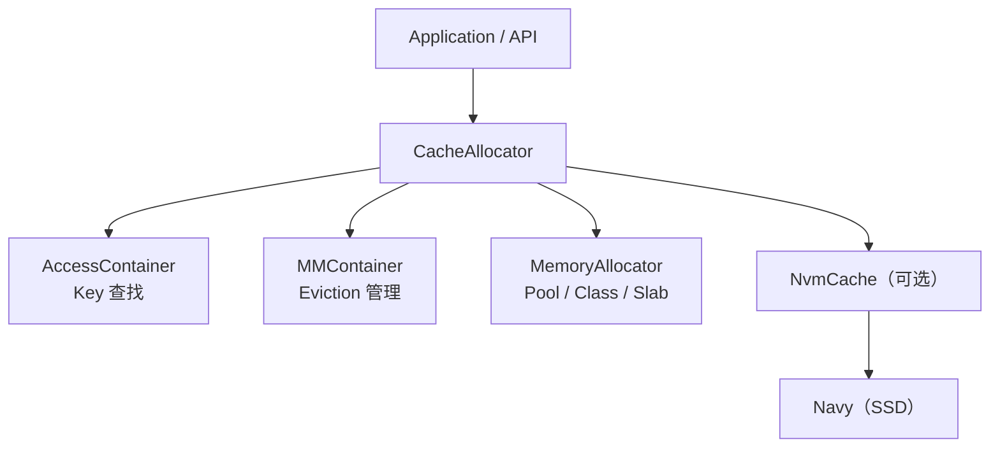
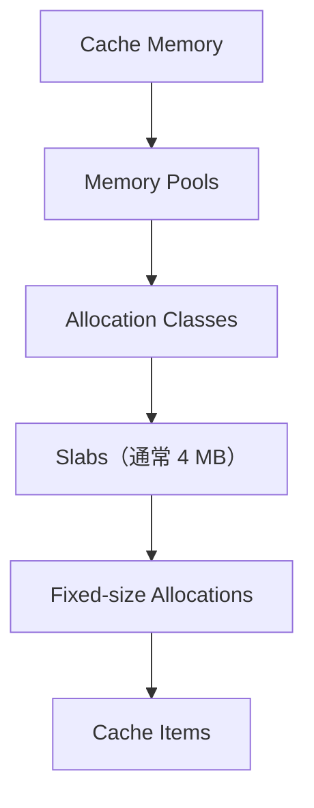
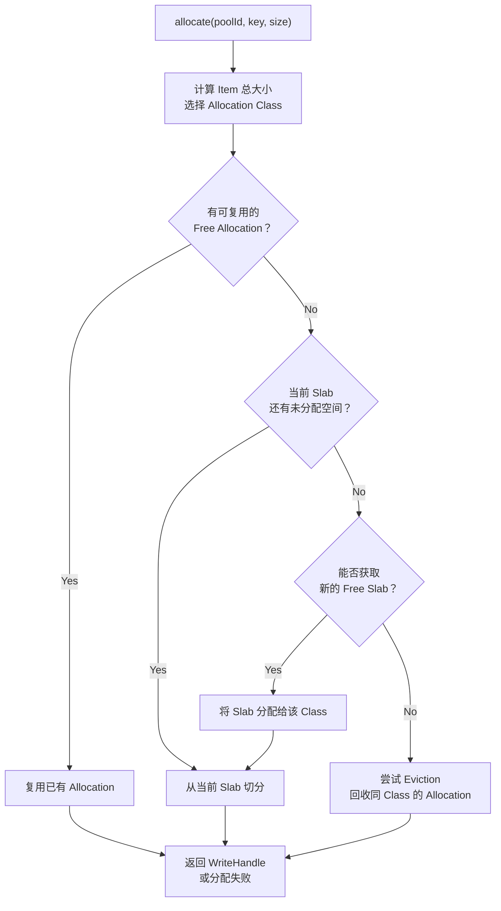

# cachelib 想要解决的问题

理解 CacheLib，首先要区分两个问题：
1. 如何实现一个高性能缓存？
2. 如何让不同业务快速构建适合自己的高性能缓存？

CacheLib 的核心目标是第二个。


注意：SSD 层是可选的。只使用 DRAM 时，CacheLib 就是内存缓存引擎；启用 Navy 后，才构成 DRAM + SSD 的 Hybrid Cache。

# cachelib 整体架构



## AccessContainer

负责查找

假设调用：
```cpp
cache.find("user:1001");
```

CacheLib 需要通过 Key 找到对应对象。

这由 AccessContainer 负责。

官方提供的实现是 ChainedHashTable。

本质上，它是一个 Hash Table，通过哈希定位 Bucket，再沿 Bucket 的链表寻找匹配的 Key。

## MMContainer

负责淘汰

MM 是 Memory Management 的缩写。

AccessContainer 解决的是：
对象在哪里？

MMContainer 解决的是：
哪个对象应该被淘汰？

例如使用 LRU 时，MMContainer 维护与缓存对象关联的 LRU 队列。

当某个对象被访问时，可以记录它的访问行为；当需要释放空间时，则根据淘汰策略寻找候选对象。

这里有一个很有意思的设计：

同一个 CacheItem 可以同时位于 Hash Table 和 LRU 链表中，而不需要存储两份对象。

这是通过 Intrusive Data Structure 实现的，也是后面学习的重要内容。

## MemoryAllocator

负责内存分配

它解决的是：
> 应该从哪一块内存中分配空间给新对象？

其基本层次如下：



# 一次 cachelib `find` 的大致流程

1. 计算 Key 的 Hash：根据 Hash 定位到 ChainedHashTable 的 Bucket。
2. 查找 CacheItem：沿着 Bucket Chain 比较 Key，定位对象。
3. 管理对象生命周期：通过 Handle 保证使用期间对象内存不会被回收。
4. 记录访问：根据配置和淘汰策略，更新 MMContainer 中的访问状态。
5. 返回 ReadHandle：应用通过 Handle 读取对象内容。

# Part 2: CacheAllocator - Cachelib 的内存管理机制

1. CacheLib 为什么需要专门的 Memory Allocator？
2. 什么是 Pool、Slab 和 Allocation Class？
3. 一个缓存对象究竟是怎样被分配内存的？
4. 为什么 Slab Allocator 仍然会产生 Internal Fragmentation？
5. 为什么 CacheLib 需要 Slab Rebalancing？

## 1. 为什么 CacheLib 不直接使用 malloc()？

但是对于 CacheLib 这样的缓存系统，还要考虑：
- 缓存对象会被频繁创建和淘汰。
- 不同对象大小差别很大。
- 很多线程可能同时分配、释放内存。
- Cache 的总内存空间通常有严格上限。
- 必须根据不同对象的缓存价值重新分配内存资源。
因此，CacheLib 使用专门的 Slab-based Memory Allocator。

核心思想：预先管理一大块内存，再将它切分成固定大小的 Slab，在 Slab 内进一步切分成相同大小的 Allocation。

官方文档明确指出，这样设计主要是为了减少碎片、支持内存重新平衡，以及实现高效的指针压缩。

[RAM Cache Design](https://cachelib.org/docs/Cache_Library_Architecture_Guide/ram_cache_design/?utm_source=chatgpt.com)

## 2. 理解内存管理的四个层次


### 2.1 memory pool

Pool 用于隔离不同类型的缓存对象。

假设一个应用缓存两种内容：
- 用户信息：需要 32 MB
- 图片信息：需要 32 MB

我们可以创建两个 Pool：

```cpp
auto userPool = cache->addPool("users", 32 * 1024 * 1024);
auto imagePool = cache->addPool("images", 32 * 1024 * 1024);
```

这样不同的工作负载就拥有相对独立的缓存空间。

例如图片数据非常热门，也不会直接占用分配给用户信息 Pool 的容量。

当然，CacheLib 可以通过 Pool Resizing 调整两者的容量分配。

需要注意：

**Pool 不是 Hash Table，而是内存管理和淘汰的隔离单位。**

整个常规 DRAM Cache 仍然可以通过统一的 AccessContainer 按 Key 查找对象，find() 不需要提供 Pool ID。

### 2.2 Slab

Slab 是 CacheLib 内存分配的基本大块单位。

CacheLib 通常采用：
$$
\boxed{\text{Slab Size}=4\text{ MiB}}
$$

也就是：
$$
4\times1024\times1024=4,194,304\text{ Bytes}
$$

假设一个 Pool 拥有 32 MiB 内存。

那么它能够容纳的 4 MiB Slab 数量为：
$$
N=\frac{32}{4}=8
$$

这 8 个 Slab 可以分配给不同的 Allocation Classes。

注意：这是忽略元数据和其他开销后的理想化计算。

### 2.3 Allocation Class

假设缓存对象的大小分别为：
```
100 Bytes
200 Bytes
400 Bytes
800 Bytes
```

如果每个对象都按精确大小单独分配，就会增加管理复杂度。

CacheLib 使用 Allocation Class，将对象按照分配大小分类。

例如，我们人为配置：
```
Class 1: 128 Bytes
Class 2: 256 Bytes
Class 3: 512 Bytes
Class 4: 1024 Bytes
```

当对象所需总大小为 400 Bytes 时，就可以从 512 Bytes 的 Allocation Class 获取空间。

### 2.4 allocation

Allocation 是 Slab 内实际分配给对象的小块内存。

假设一个 Slab 为 4 MiB，所属 Allocation Class 的大小是 512 Bytes。

那么理论上可以切分：
$$
N=\frac{4\times1024\times1024}{512}
$$

得到：
$$
\boxed{N=8192}
$$

即一个 Slab 理论上可以容纳 8192 个大小为 512 Bytes 的 Allocation。

实际可用数量由内存布局和相关开销决定。

## 3. 一个 CacheItem 占用多少内存

**Slab Allocation 主要解决外部碎片和内存管理问题，但仍可能产生内部碎片。**

## 4. CacheAllocator 完整内存分配过程



**Step 1：查找 Free Allocation**

假设原来存在一个缓存对象：
key = "user:11"
size = 512 B


后来被 Eviction 淘汰。

那么它占用的 512 B Allocation 可以被重新利用。

新对象无需申请新的 Slab，直接复用即可。

**Step 2：从当前 Slab 切分**

如果没有 Free Allocation，CacheLib 尝试从当前正在切分的 Slab 中分配空间。

假设一个 512 B Class 的 Slab：
已使用：8000 Allocations
容量：  8192 Allocations（理论上）


那么还有 192 个位置可用。

因此可以继续分配。

**Step 3：获取新的 Slab**

如果当前 Slab 已满，Allocation Class 会尝试获得另一块 Slab。

可能的来源包括：
1. Allocation Class 自身的空闲 Slab。
2. 所属 Pool 的空闲 Slab。
3. 全局 SlabAllocator 尚未分配的 Slab。
成功后，将新 Slab 指派给对应的 Allocation Class。
Step 4：Eviction
如果已经没有可用的新 Slab，CacheAllocator 就需要尝试淘汰对象，回收已有 Allocation。

这时：
- CacheAllocator 负责协调分配过程。
- MMContainer 根据淘汰策略提供候选对象。
- CacheAllocator 检查对象是否可以安全回收。
例如，一个对象还有其他线程持有的 Handle，就不能直接释放其内存。

如果一定次数的淘汰尝试都无法得到可用空间，allocate() 也可能失败

## 5. 为什么 CacheLib 需要 Slab Rebalancing？

Slab rebalancing 是在同一个 memory pool 内，把 slab 从一个 allocation class 调给另一个，让内存分配适应对象大小的变化。 官方说明

例如，一个 pool 中有两类槽位：

调整前：
128 B class：8 个 slab，空闲槽位很多
1 KiB class：2 个 slab，空间紧张，经常淘汰

虽然 pool 里还有空闲空间，但它们属于 128 B class，无法直接满足 1 KiB 的分配请求。Rebalancing 可以转移一个 slab：

调整后：
128 B class：7 个 slab
1 KiB class：3 个 slab

转移的关键是：先清空整个 slab，再按新尺寸重新切分。

1. 从提供空间的 class 中选出一个 slab。
2. 移动或淘汰其中仍有效的 Item，使这个 slab 可以安全释放。
3. 将 slab 交给接收空间的 class，或先放回 pool 的空闲 slab 列表。
4. 接收方按自己的槽位大小使用它。调整流程

所以，它和前面讲的普通 eviction 有区别：

| 操作 | 腾出什么 | 空间之后用于什么 |
|---|---|---|
| 普通 eviction | 一个 Item 的槽位 | 供原 allocation class 复用 |
| Slab rebalancing | 整个 slab | 可交给另一个 allocation class |

它解决的是“内存分在了不再需要那么多空间的 class 中”这个问题。 调整前后 pool 的总容量通常不变，变化的是各个 class 分到多少 slab。

**Eviction 负责回收单个 CacheItem 的空间，Slab Rebalancing 负责调整不同大小对象之间的内存容量分布。**

## Part 2 知识总结

|概念|一句话理解|
|---|---|
|Pool|隔离不同缓存工作负载的内存空间|
|Slab|CacheLib 内存分配和重新平衡的基本大块单位，通常为 4 MiB|
|Allocation Class|负责某一种固定分配大小的内存|
|Allocation|Slab 中实际分配给对象的一块空间|
|Internal Fragmentation|对象实际使用空间小于 Allocation 大小产生的浪费|
|Eviction|回收缓存对象占用的空间|
|Slab Rebalancing|重新调整不同 Allocation Classes 的内存容量|

# Part 3：CacheItem、Handle 与 Hash Table

上一部分解决了一个问题：
> CacheLib 如何为对象分配内存？

现在要解决另外两个问题：
1. 已经分配的 CacheItem 如何通过 Key 被找到？
2. 当多个线程同时读取、修改和淘汰对象时，CacheLib 如何保证内存安全？

这一部分的核心组件是：
- CacheItem
- ReadHandle / WriteHandle
- AccessContainer
- ChainedHashTable
- MMContainer
- Intrusive Data Structure
- Compressed Pointer

## 1. CacheItem：一个缓存对象的内存结构


## 2. AccessContainer：通过 Key 定位 CacheItem

CacheLib 使用的索引结构是 ChainedHashTable，即采用 Separate Chaining 处理哈希冲突的 Hash Table。

例如：
cache->find("user:42");


Step 1：Hash Key

首先计算：
$$
h(\text{"user:42"})
$$

假设 Hash Table 有 1024 个 Buckets：
$$
bucket=h(key)\bmod1024
$$

假设得到：
$$
bucket=37
$$

那么 CacheLib 首先访问 Bucket 37。

Step 2：访问 Bucket Chain

由于不同 Key 可能产生相同的 Bucket Index，因此 Bucket 内需要解决 Hash Collision。

# Part 4: CacheLib Eviction Policy — 缓存淘汰策略

https://chatgpt.com/s/t_6ae40f3b24288191977bb29c21eaab56

# Part 5: Slab Rebalancing — CacheLib 如何动态调整内存？

https://chatgpt.com/s/t_6ae40f674fe48191b8fc4938abb24b89

# Part 6：Hybrid Cache & Navy — CacheLib 的 SSD 缓存架构

本节重点解决四个问题：
1. CacheLib 如何将 DRAM 和 SSD 组成两级缓存？
2. 为什么 Navy 要同时设计 BigHash 和 BlockCache？
3. SSD Cache 的 DRAM Index Overhead 和 Write Amplification 从何而来？
4. Admission Policy 和 Eviction Policy 如何配合？

## 4. BigHash：针对 Small Objects 的缓存设计

假设我们需要在 SSD 上缓存：

```
key = "user:42"
value = 100 Bytes
```

一个看似简单的方法是使用 Hash Table。

但如果 SSD 中有十亿个对象，我们是否需要在 DRAM 中保存：
```
Key → SSD Offset
```
这样的映射？

如果每个对象都需要一个独立的索引项，那么 DRAM 开销可能非常高。

BigHash 采用了另一种方法。

### 4.1 Set-Associative Cache

当查找 Key 时：
1. 计算 Key 的 Hash。
2. 通过 Hash 确定 Bucket 位置。
3. 从 SSD 读取整个 Bucket。
4. 在 Bucket 内搜索匹配的 Key。
它与普通 Hash Table 的区别在于：

BigHash 不需要在 DRAM 中为每一个对象保存独立的 SSD Offset。

因为对象所在的 Bucket 可以由 Key 的 Hash 直接确定。

### 4.2 Bloom Filter 的作用

### 4.3 BigHash 的核心问题：Write Amplification

> 这就是 Small Object SSD Cache 面临的核心矛盾：
> BigHash 节省了 DRAM 索引开销，但对于很小的对象，更新整个 Bucket 会产生较高的 Flash Write Amplification。

## 5. BlockCache：针对 Large Objects 的缓存设计

BlockCache 使用另一种结构：Log-Structured Cache。

它将 SSD 划分为较大的 Regions。

例如：
$$
\text{Region Size}=16\text{ MiB}
$$

然后将对象依次追加写入 Region。

### 5.1 为什么追加写入更适合 SSD？

假设：
```
Item A = 4 KiB
Item B = 8 KiB
Item C = 16 KiB
```

BlockCache 可以将它们依次写入缓存缓冲区，然后批量写入 SSD。

这种方式避免了为了更新一个小对象就反复改写一个固定 Bucket。

它与你之前学习 RocksDB LSM-Tree 时的 Sequential Write 思想有相似之处。

但是二者不能混为一谈：
- RocksDB 的日志结构主要服务于持久化 KV 存储。
- Navy BlockCache 的追加写入服务于 SSD 缓存，并可以直接淘汰对象。

### 5.2 BlockCache 的问题：DRAM Index Overhead
BlockCache 为了快速定位对象，需要维护一个内存索引。

概念上：
```
Hash(Key) → SSD Offset
```

如果 SSD 缓存了十亿个对象，而索引每个对象大约需要 12 Bytes：
$$
10^9\times12=12\text{ GB}
$$

那么，仅索引就大约需要 12 GB DRAM。

对于缓存数十亿个只有 100 Bytes 左右的对象，这个成本非常高。

CacheLib 官方文档给出的 BlockCache 索引估算约为每个对象 12 Bytes。[navy overview](https://cachelib.org/docs/Cache_Library_Architecture_Guide/navy_overview/?utm_source=chatgpt.com)

因此：

BlockCache 可以减少小粒度随机改写，但必须付出逐对象索引的 DRAM 成本。

### 5.3 Region Reclaim

BlockCache 还需要处理另外一个问题。

假设一个 Region 中存储：A、B、C、D

后来 A、C 被淘汰。

由于 SSD 中的数据是追加写入的，BlockCache 不会简单地在原位置插入新的对象填补所有空隙。

它需要在 Region 回收时：
- 识别仍然有效的对象。
- 根据策略选择保留或淘汰。
- 必要时将有效对象重新写入其他 Region。
- 最终回收整个 Region。
这一过程可能产生额外的数据复制和 Flash Writes。

你可以把它与 LSM-Tree 中 Compaction 产生的 Write Amplification 联系起来理解，但两者的回收目标和语义并不相同。

# 其他问题

## 什么时候用 big hash，什么时候用 block cache

主要按对象大小选择：小对象用 BigHash，较大对象用 BlockCache。 在 Navy 中可以同时启用两者，配置大小阈值后，由引擎自动分流。官方说明 (https://cachelib.org/docs/Cache_Library_Architecture_Guide/navy_overview/)

例如，假设配置阈值为 1 KiB：

对象大小 ≤ 1 KiB → BigHash
对象大小 > 1 KiB → BlockCache

这里的 1 KiB 只是示例，阈值可以配置，且必须小于 BigHash 的桶大小。配置文档 (https://cachelib.org/docs/Cache_Library_User_Guides/Configure_HybridCache/)

它们的区别来自一个权衡：DRAM 索引开销与 SSD 读写开销。

|  | BigHash | BlockCache |
|---|---|---|
| 适合对象 | 远小于设备块的小对象 | 接近或大于设备块的对象 |
| SSD 组织 | 哈希桶，一个桶放多个对象 | 对象追加写入 Region |
| 如何定位 | 根据 Key 直接计算桶位置 | 查询 DRAM 中的对象索引 |
| DRAM 开销 | 无需为每个对象维护位置索引；可配置 Bloom filter | 每个对象需要索引项 |
| 主要代价 | 更新小对象也需要读改写整个桶 | 索引占内存，Region 回收可能需要重写存活对象 |

引擎设计 (https://cachelib.org/docs/Cache_Library_Architecture_Guide/navy_overview/)

为什么小对象适合 BigHash？

假设对象只有 100 B，却需要约 12 B 的 DRAM 索引，光索引就相当于对象大小的 12%。对象数量越多，这部分内存成本越突出。

BigHash 可以直接从 Key 算出 SSD 桶位置，省去逐对象的位置索引。但代价是：假设桶为 4 KiB，更新一个 100 B 对象，也可能需要读改写整个 4 KiB 桶。

为什么较大对象适合 BlockCache？

如果对象是 10 KiB，同样约 12 B 的索引开销只占约 0.12%，就容易接受了。BlockCache 利用内存索引定位对象，并通过缓冲、追加写入来组织 SSD 写入；较大对象也不适合塞进 BigHash 的小桶中。索引与写入设计 (https://cachelib.org/docs/Cache_Library_Architecture_Guide/navy_overview/)

因此，小对象优先省逐对象的 DRAM 索引；大对象可以承担索引成本，换取适合它们的存储和 I/O 方式。

另外，你前面看的 KLog 是 Kangaroo 的组成部分；这里讨论的是 Navy 的 BigHash／BlockCache 组合，不能直接把 KLog 等同于 BlockCache。


