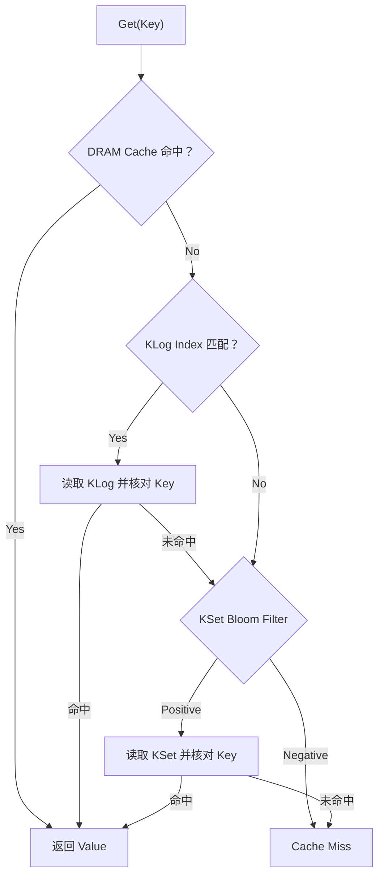

# intro


# Part 3：Kangaroo 整体架构与完整读写流程

## 2. Lookup：读取一个对象需要经过哪些步骤？



## 3. Insert：新对象如何进入 Kangaroo？


# 其他问题

##  KLog 中的 tag

“使用紧凑的 Tag”就是：DRAM 索引里只保存 Key 的一小段哈希指纹，用它来筛选候选对象。

这里的 KLog 是 Kangaroo 设计中的组件。论文将 Tag 定义为 Key 的部分哈希值（partial hash）。论文 §4.2 (https://www.cs.cmu.edu/~beckmann/publications/papers/2021.sosp.kangaroo.pdf)

例如，假设为了演示，我们取哈希值的低 8 位作为 Tag：
```
Key = "user_123"
Hash(Key) = 0xA72F3B91
Tag       =       0x91
```
原来你写的索引：
```
"user_123" → Flash Offset 0x5000
```
更接近实际的简化表示是：
```
某个哈希桶内：
    Tag 0x91 → Flash Offset 0x5000

SSD 的 0x5000 对应位置：
    完整 Key = "user_123"
    Value    = ...
```

哈希桶负责缩小查找范围，Tag 负责在桶内进一步筛选，SSD 上的完整 Key 负责最终确认。

为什么可能出现假阳性？因为两个不同的 Key，可能落到同一个桶，而且 Tag 也相同：
```
                    桶编号       Tag
"user_123"            42         0x91
"order_789"           42         0x91
```

如果索引项实际对应 "user_123"，此时查询 "order_789"：

1. 找到桶 42。
2. 发现 Tag 都是 0x91，认为这个位置可能有目标对象。
3. 读取 SSD，发现完整 Key 是 "user_123"。
4. 完整 Key 不匹配，因此这个候选对象不算命中。

所以，Tag 相同只表示“值得读出来检查”，不能证明 Key 相同。核对完整 Key 可以避免返回错误的 Value；假阳性的代价主要是额外的 SSD 读取。查找流程 (https://www.cs.cmu.edu/~beckmann/publications/papers/2022.tos.kangaroo.pdf)

这样设计是为了节省 DRAM：假设完整 Key 有 20 字节，而 Tag 只有约 1 字节，海量对象的索引就能省下大量空间。实际论文表 1 的一个配置使用 9 bit Tag，整个 KLog 索引项还包括 offset、链表指针等，共 48 bit，也就是 6 字节；Tag 的位数不是固定只能取 8 位。论文表 1 (https://www.cs.cmu.edu/~beckmann/publications/papers/2021.sosp.kangaroo.pdf)

### 为什么要使用紧凑的tag，是为了能装下更多的 index 吗

对，就是为了让有限的 DRAM 能容纳更多索引项，从而索引更多 SSD 上的对象。

也可以反过来说：索引相同数量的对象时，使用 Tag 能减少 DRAM 占用。

例如，假设有 1 亿个索引项，只比较 Key 和 Tag 这部分：

| 保存方式 | 每项占用 | 总占用 |
|---|---:|---:|
| 完整 Key | 20 字节 | 约 2 GB |
| 紧凑 Tag | 9 bit | 约 112.5 MB |

这还没算 offset、指针等其他字段，而且假设按位紧凑存储。

对于 KLog 这种缓存大量小对象的设计，索引开销尤其重要：对象本身可能只有几十到几百字节，如果每个对象都需要一个很大的 DRAM 索引项，使用 SSD 节省内存成本的效果就会被削弱。

它做的权衡是：

- Tag 越短：索引越省内存，但碰撞更多，可能增加无效的 SSD 读取。
- Tag 越长：碰撞更少，但索引占用更多内存。

因此，设计目标是 用少量额外 SSD 读取，换取显著的 DRAM 节省。完整 Key 仍保存在 SSD 上，用于最终核对，所以 Tag 碰撞不会导致返回错误的 Value。