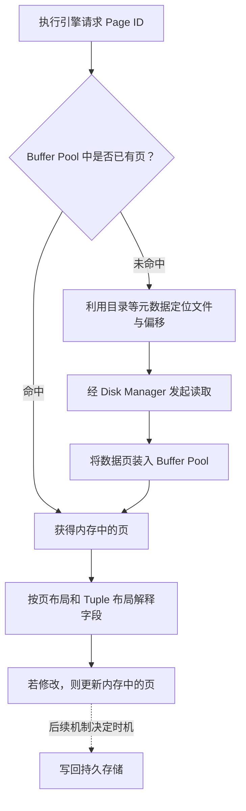

# 03 Database Storage：Files & Pages

> 来源：[03-storage1.pdf](../slides/03-storage1.pdf)，Lecture #03。
> 本笔记中的“PDF 页”指阅读器显示的实际页码（共 141 页），不是幻灯片右上角的编号。课件含大量逐步展示的重复页，下面按主题合并。
> 文中的演算、操作步骤和自测题是帮助理解的补充；具体产品的布局、阈值和硬件数值以课件示例理解，不视为所有实现的统一规则。

## 0. 学习路线：把一行 SQL 数据一路拆到字节

本讲回答：**数据库中的表和记录，最终怎样组织成磁盘上的字节？**

可以沿着四层结构学习：

```text
Database
  └─ File：用一个或多个文件保存数据库
       └─ Page：以固定大小的页组织文件内容
            └─ Tuple：在页中保存记录
                 └─ Attribute：将字段编码成字节
```

建议分四步学，每学完一步先回答右边的问题：

| 顺序 | 内容 | 学完应能回答 | PDF 页 |
| --- | --- | --- | --- |
| 1 | 存储层次与磁盘架构 | 为什么数据库要以页为单位管理数据？ | 10–35 |
| 2 | 文件、页和目录 | 给定 Page ID，怎样找到对应的数据？ | 36–55 |
| 3 | 页布局与 Record ID | 记录移动后，怎样继续定位它？ | 56–81 |
| 4 | 元组与字段布局 | 怎样把一串字节解释成一行数据？ | 82–138 |

本讲重点是**磁盘上的表示方式**。内存缓存的替换、淘汰和刷盘策略属于后续 Buffer Pool 主题。

**开始前只需确认三个前置概念**：一张表由行和列组成；内存与持久存储的区别；字节、偏移与指针的含义。暂时不会 B+ Tree、事务恢复或缓存淘汰算法，不影响学习本讲。

学习时准备纸笔：第一轮按上表建立四层结构；第二轮完成 §3.4 的页内状态推演；最后遮住答案做 §10 的自测。完成的标准是能沿着 RID 找到字段，并解释每层元数据为什么存在。

## 1. 为什么需要专门设计数据库存储？

### 1.1 Disk-oriented DBMS 的基本假设

对应 PDF 页 10–19。

数据库的主要持久副本放在非易失性存储上；内存保存当前需要访问的一部分数据。数据库可以比内存更大，因此不能假设整张表始终在内存中。

存储层次从上到下通常是：

```text
CPU Registers → CPU Caches → DRAM → SSD → HDD → Network Storage
更快、容量更小、单位容量更贵          更慢、容量更大、单位容量更便宜
```

这里要掌握两个区别：

- **Volatile / Non-volatile**：前者断电后丢失数据，后者用于持久保存。
- **Byte-addressable / Block-addressable**：CPU 能按地址访问内存中的字节；磁盘 I/O 通常以块为单位，不能把磁盘上的某个字节直接当普通内存读取。

课件给出的访问延迟用于说明数量级：

| 层次 | 课件示例延迟 |
| --- | --- |
| L1 Cache | 1 ns |
| L2 Cache | 4 ns |
| DRAM | 100 ns |
| SSD | 16,000 ns，即 16 μs |
| HDD | 2,000,000 ns，即 2 ms |
| Network Storage | 约 50 ms |

这些不是固定的硬件承诺。应记住的是：**一次存储访问可能比一次内存访问慢几个数量级，减少 I/O 比少做几次普通计算更有价值。** 课件也指出，单核性能提升放缓、核心数增加，DBMS 还需要利用并行性。

### 1.2 为什么尽量使用顺序 I/O？

顺序访问连续的数据块，通常比访问散布在各处的数据块更高效。HDD 尤其受寻道和旋转延迟影响；SSD 没有机械寻道，但也不能因此把随机 I/O 当作没有代价。

这会影响数据库算法：

1. 尽量让相关数据在存储上连续，减少离散访问。
2. 一次申请多个页，便于形成连续空间。这组分配的页称为 **Extent**。
3. 避免大量零散的随机页写入。

注意：磁盘支持随机访问。“顺序访问更有利”描述的是性能倾向。

### 1.3 从磁盘到执行引擎：一次读写的路径

对应 PDF 页 20–35。



如果阅读器不支持 Mermaid，可按下表理解同一条路径：

| 分支 | 主要步骤 | 是否因获取该数据页而发起读取 |
| --- | --- | --- |
| Buffer Pool 命中 | Page ID → 内存中的页 → 解释布局 | 不需要 |
| Buffer Pool 未命中 | Page ID → 文件定位 → 发起读取 → 内存中的页 → 解释布局 | 需要，但不据此断言设备实际读取次数 |
| 修改已有页 | 修改内存页 → 由后续机制安排写回 | 修改动作本身不代表已落盘 |

图是职责层次的简化说明，省略了缓存空间不足时的处理、并发和错误分支。目录本身也可能需要 I/O；OS 缓存等下层机制还会影响设备是否真正执行读取。

按课件动画理解一次访问：

1. 执行引擎需要 Page #2。
2. DBMS 利用目录等元数据定位磁盘上的页。
3. 将页读入 Buffer Pool，然后向执行引擎提供内存中的访问入口。
4. 执行引擎按 Page Layout 解释记录，并可修改内存中的页。
5. 修改后的内容需要在之后写回持久存储；何时写回由后续机制决定。

**修改内存中的页，不等于修改已经持久化。** 本讲建立这条路径，暂不展开恢复和并发控制协议。

## 2. File Storage：文件中如何组织页？

### 2.1 操作系统看到文件，DBMS 看到结构

对应 PDF 页 36–40。

DBMS 通常把数据库存为一个或多个具有自身格式的文件。操作系统可以读写文件字节，却不知道其中哪些字节是表、索引或记录。

Storage Manager 的职责包括：

- 维护数据库文件，将文件组织成页的集合。
- 跟踪页的读写和可用空间。
- 某些系统还调度 I/O，改善空间局部性和时间局部性。

课件提到，早期系统会直接在原始块设备上实现自己的文件系统；较新的系统多数使用已有文件系统。无论底层采用哪种方式，数据库仍需定义自己的数据格式。

### 2.2 Page 是什么？

**Page 是固定大小的数据块，是数据库组织和传输数据的基本单位之一。**

页可以保存 Tuple、元数据、索引节点或日志记录等。多数系统不会在同一页混合不同页类型。

每个页有 Page ID，但唯一性范围依系统而定，可能是实例、数据库或表。DBMS 通过一层间接映射，将 Page ID 转换成文件和物理位置。

因此，应区分：

```text
Page ID：数据库用来标识页
文件偏移：页在文件中的位置
内存指针：页载入某次内存位置后，访问其字节的入口
```

三者不是同一个概念，不能互相直接替代。

### 2.3 三种“页”不要混淆

对应 PDF 页 41–44。

| 名称 | 本讲中的含义 | 课件给出的大小示例 |
| --- | --- | --- |
| Hardware Page | 存储设备能够保证故障安全写入的粒度 | 通常 4 KB |
| OS Page | 操作系统虚拟内存管理的分页单位 | 通常 4 KB，也有 2 MB / 1 GB 大页 |
| Database Page | DBMS 自己定义的存储组织单位 | 课件列出 512 B–32 KB 的常见范围 |

这里的 Hardware Page 使用课件的存储设备语境，应与 CPU 的虚拟内存分页概念区分。实际原子写入保证依赖设备和 I/O 路径。

理解上的补充：如果数据库页大于底层可保证的原子写入单位，不能据此假设整个数据库页会一次性安全落盘。恢复机制需要处理可能的部分写入，这将在后续课程展开。

页大小取决于负载：

- **大页**：一次读取带回更多记录，可能有利于扫描；也可能读取许多无关数据。
- **小页**：小范围更新涉及的数据量较少，但扫描相同数据可能需要管理更多页。

课件在整页 I/O 模型下强调：即使只改页中很小的一部分，也可能需要写回整个页。它还提到，偏读负载的专用系统可以使用 1 MB 甚至更大的页，因此上面的常见范围不是上限。

### 2.4 Heap File：无序页集合

对应 PDF 页 45–53。

课件列出 Heap、Tree、Sequential / Sorted、Hashing 等文件组织方式，本讲主要展开 **Heap File**。

Heap File 是保存记录的无序页集合；记录不要求按某个键排序。它应支持创建、获取、写入、删除页，以及遍历所有页。

这里的 Heap 与堆排序、优先队列中的 Heap 无关；它也不意味着磁盘地址完全随机。

最简单的单文件布局可以这样定位页：

```text
offset = page_number × page_size
```

例如，页号从 0 开始，页大小为 4,096 B，则 Page #2 从文件偏移 8,192 B 开始。这个公式假设页等长、从文件起点连续排列且没有额外前缀；多文件或更复杂布局还需要目录映射。

### 2.5 Page Directory：既要找页，也要找空闲空间

对应 PDF 页 54–55。

DBMS 使用专门的目录页记录数据库对象和数据页位置等信息，还会维护每页空闲空间、空页列表和页类型。

它帮助回答两类问题：

1. **读取**：我要的页在哪个文件、哪个位置？
2. **插入**：哪个页有足够的空间容纳新记录？

例如，插入一条约 200 B 的记录时，可以先查空间元数据，而不必把所有数据页读出来逐个检查。实际还需计入槽位等开销。

目录必须与数据页保持一致。如果目录把已满页标为空闲，或没有记录一个已分配页，后续操作就可能定位错误或产生额外工作。

**Page Directory 管的是页及其元数据；下一节的 Slot Array 管的是单个页内部的记录位置。**

把四层定位所需的元数据放在一起看：

| 要解决的问题 | 依靠的信息 | 输出 |
| --- | --- | --- |
| 页在哪里？ | 文件组织与页定位元数据 | 文件标识、文件内偏移 |
| 页是否已在内存？ | Buffer Pool 的页映射，后续课展开 | 内存中的页入口 |
| 记录在页内哪里？ | Slot Array | Tuple 的页内偏移 |
| 字段在哪里、如何解释？ | Catalog / Schema、Tuple Header 与布局 | 字段值或外置值引用 |

同样是“目录”或“映射”，它们的输入、输出和生命周期并不相同。

## 3. Page Layout：一个页内部怎样存记录？

### 3.1 Page Header 和本讲假设

对应 PDF 页 57–61。

页通常由 Header 和内容区构成。Header 可包含页大小、校验和、DBMS 版本、事务可见性、压缩编码信息、Schema 信息或数据摘要，具体字段依系统而定。

课件列出三类布局：Tuple-oriented、Log-structured、Index-organized。本讲重点是第一类，并先假设：

- 使用行式存储，一条 Tuple 集中保存一行的属性。
- 每条 Tuple 可以放进一个页。

后面再用 Overflow Pages 处理大字段。

### 3.2 为什么“记录数量 + 顺序追加”不够？

对应 PDF 页 62–68。

最直接的方案是在页头记录 Tuple 数量，然后把新记录追加到末尾。但它遇到两个问题：

- **删除**：中间留下空洞；若移动后续记录填洞，原有字节位置就改变了。
- **变长记录**：无法仅靠“第几条 × 固定长度”计算位置，更新变长后还可能需要搬动记录。

因此，需要将“记录的标识”和“记录当前的字节偏移”分开。

### 3.3 Slotted Page：通过槽位间接定位

对应 PDF 页 69–79，是本讲的重点。

Slotted Page 在页中维护一个 **Slot Array**。槽位记录 Tuple 在页内的起始偏移；实际实现也可记录长度、状态等信息。

```text
低地址
+-----------------------------+
| Page Header                 |
+-----------------------------+
| Slot 0 | Slot 1 | Slot 2 ... |  槽数组向后增长
+-----------------------------+
|                             |
|         Free Space          |
|                             |
+-----------------------------+
| Tuple C | Tuple B | Tuple A |  记录区从页尾向前增长
+-----------------------------+
高地址
```

这是一种常见示意布局，具体字节格式依实现而定。课件页头跟踪已使用槽位数量和边界位置等元数据。

下面用一张 256 B 的教学页展示实际偏移。每条记录的长度已包含其 Tuple Header，槽号从 0 开始；图中的 `S0` 是 Slot 0，偏移均相对于页起点。


图中的核心关系是：**目录槽与记录字节分开存放；移动记录字节时更新槽内偏移，保持存活记录的槽号。**

查找一条记录的过程是：

```text
(Page ID, Slot ID)
        ↓ 读入对应页
Slot Array[Slot ID]
        ↓ 得到页内 offset
页起始地址 + offset
        ↓
Tuple 字节
```

**为什么这层间接寻址有价值？**

假设 Slot 2 原来指向 offset 3,000。页内整理后，该记录移到 offset 3,300：

```text
整理前：Slot 2 → 3000 → Tuple C
整理后：Slot 2 → 3300 → Tuple C
```

只要保持 Slot 2 对同一条存活记录的映射，外部引用 `(Page ID, 2)` 就不必随页内搬移而改变。

### 3.4 插入、删除和整理怎样配合？

下面是根据 Slotted Page 原理补充的典型操作过程，具体回收时机依实现而定。

**插入**：检查记录空间和槽位开销；写入 Tuple；创建或复用槽位；更新页头和空闲空间信息。当前页放不下时，需要选择其他页或分配新页。

**删除**：先使槽位对应记录失效，记录字节可能暂时留下空洞。物理空间也可能因为事务可见性而不能立即回收。

**整理（Compaction）**：移动仍有效的记录，将空洞合并成连续空间，并修改对应槽位中的偏移。不能随意重排仍被引用的槽号。

要区分两个量：**总空闲空间**与**连续空闲空间**。总共有 500 B 空闲，不代表立刻能插入一条 400 B 的连续记录；如果空间碎成几段，可能要先整理。

#### 手推：总空闲够了，为什么仍放不下？

以下是教学模型，并非某个产品的页格式：页大小 256 B，Page Header 24 B，每个槽位 8 B，保存 offset、length 和状态；记录从页尾向前分配。删除立即使记录空间可回收，但不搬动其他记录，也不缩短槽数组。暂不考虑事务、并发、对齐与日志。

依次插入 A（48 B）、B（64 B）、C（48 B），槽数组占 `3 × 8 = 24 B`，其末端为 offset 48。

| 操作后状态 | Slot 0 | Slot 1 | Slot 2 | 总空闲 | 槽数组与记录区之间的连续空闲 |
| --- | --- | --- | --- | --- | --- |
| 插入 A、B、C | A @208，48 B | B @144，64 B | C @96，48 B | 48 B | `[48, 96)`，48 B |
| 删除 B | A @208，48 B | 无效，可复用 | C @96，48 B | 112 B | `[48, 96)`，48 B |
| 尝试插入 D（80 B） | 不变 | 仍无效 | 不变 | 112 B | 48 B，插入失败 |
| 整理存活记录 | A @208，48 B | 仍无效 | C @160，48 B | 112 B | `[48, 160)`，112 B |
| 插入 D，复用 Slot 1 | A @208，48 B | D @80，80 B | C @160，48 B | 32 B | `[48, 80)`，32 B |

其中 `[a, b)` 表示包含 a、不包含 b 的字节范围，大小为 `b - a`。

1. 删除 B 后，多出一个 `[144, 208)` 的 64 B 空洞，与前部的 48 B 空闲不相邻。最大的空闲段也只有 64 B，装不下连续的 80 B。
2. 整理将 C 从 `[96, 144)` 移到 `[160, 208)`，并把 Slot 2 的 offset 从 96 改成 160；A 不动。
3. 原 RID `(Page 7, Slot 2)` 仍指向 C。整理改变了字节位置，未改变该存活记录的槽号。
4. D 使用 `[80, 160)`，并复用无效的 Slot 1，因此没有新增槽位开销。
5. 旧记录 B 的 RID 此后可能定位到 D。RID 的这种槽位复用，正是应用不能把物理位置当永久身份的原因。

**整理必须保持的条件**：存活记录字节不被破坏；每个有效槽位都指向对应记录；页头空间边界与实际布局一致；槽数组与记录区不重叠。整理合并了空闲空间，没有凭空增加空闲字节。

[打开 Slotted Page 逐步演示](./demos/03-slotted-page.html)：按“下一步”观察插入、删除、失败、整理与槽位复用；可后退或重置。先预测下一步的偏移和空闲量，再操作核对。

### 3.5 一个页容量练习

补充例子：设页大小为 4,096 B，页头为 64 B，每条 Tuple 为 100 B，每个槽位为 4 B，不考虑额外对齐和碎片。

```text
64 + n × (100 + 4) ≤ 4096
n ≤ floor((4096 - 64) / 104) = 38
```

因此最多放 38 条，剩余 `4096 - 64 - 38 × 104 = 80 B`。只计算 Tuple 数据、不计算 Slot Array，会高估容量。

## 4. Record ID：怎样在数据库中定位一条记录？

对应 PDF 页 80–81。

DBMS 为记录提供内部标识 **Record ID（RID）**，一种典型形式是：

```text
RID = (File ID, Page ID, Slot ID)
```

有些系统在上下文已确定文件时只需 `(Page ID, Slot ID)`。RID 往往不必作为字段重复存入 Tuple，因为它可以由位置推导。

| 概念 | 回答的问题 |
| --- | --- |
| Primary Key | 在业务和关系模型中，这是哪一行？ |
| Record ID | 在 DBMS 当前存储结构中，怎样定位这条记录？ |
| 内存指针 | 当前加载到内存后，字节位于哪里？ |

槽位间接寻址能支持**页内搬移**时继续定位记录，但不自动保证跨页移动、更新或表重写后 RID 永远不变。删除后复用槽位，也不代表新旧记录身份相同。

因此，应用不应给内部物理 RID 赋予业务含义。课件以 SQLite 的隐藏 ROWID 说明某些系统会采用不同设计；不要据此假设所有表、所有 DBMS 的 RID 都是普通业务主键。

## 5. Tuple Layout：怎样把一条记录解释成字段？

### 5.1 Tuple Header 与 Schema 各自负责什么？

对应 PDF 页 83–90。

```text
Tuple = Header + Attribute Data
```

Tuple Header 常包含事务可见性信息和 NULL 位图。完整的表 Schema 通常保存在 DBMS Catalog 中，不需要每条记录都重复保存字段名和类型。

解码需要三类信息配合：

1. **Catalog / Schema**：有哪些列、各是什么类型，以及对应布局信息。
2. **Tuple Header**：本条记录的 NULL、可见性等状态。
3. **数据字节**：按布局读取并解释为实际值。

例如 `(id INT, value BIGINT)` 的简化记录，可以在 Header 后保存 id 和 value。但不能在所有实现中直接假设 value 紧跟在 id 的第 4 个字节之后，还要考虑对齐、编码等规则。

### 5.2 为什么字段需要对齐？

对应 PDF 页 91–104。

CPU 对多字节数据的访问有对齐要求或性能偏好。把数据紧密拼接，可能使字段跨越边界，带来额外访问工作；具体限制依处理器和访问方式而定。

课件示例：

```sql
CREATE TABLE foo (
  id INT PRIMARY KEY,  -- 4 B
  cdate TIMESTAMP,     -- 示例按 8 B
  color CHAR(2),       -- 示例按 2 B
  zipcode INT         -- 4 B
);
```

字段净大小是 18 B，但实际布局还可能加入 Padding。

课件展示两种办法：

- **Padding**：增加填充，使字段从合适的边界开始。简单，但占空间。
- **Reordering**：调整物理字段顺序，减少填充。例如将 id 与 zipcode 放在一起凑成 8 B，再放 cdate，最后放 color 和必要的填充。

在课件简化的 8 B 分组示例中，逐字段填充可占 32 B；重排后可占 24 B，均未计 Tuple Header。这是教学示例，不是说每个 4 B 字段在实际系统中都必须占满 8 B。

**SQL 中的列顺序不必等于物理存储顺序。** DBMS 只要掌握映射关系，就能返回正确的逻辑列。

空间节省还会影响性能：每页容纳更多记录，扫描所需页数减少，Buffer Pool 也能缓存更多有效数据。


图按课件的 8 B 分组模型绘制，不含 Tuple Header。无法查看图片时，可按下面的范围手推；`pad` 是填充字节：

| 布局 | 字段与填充的字节范围 | 总大小 |
| --- | --- | --- |
| 逐字段填充 | id `[0,4)`，pad `[4,8)`；cdate `[8,16)`；color `[16,18)`，pad `[18,24)`；zipcode `[24,28)`，pad `[28,32)` | 32 B |
| 重排 | id `[0,4)`，zipcode `[4,8)`；cdate `[8,16)`；color `[16,18)`，pad `[18,24)` | 24 B |

两种布局字段净数据都是 18 B，填充分别为 14 B 和 6 B。若按 §3.5 的 4,096 B 页、64 B 页头、4 B 槽位计算，并仅为比较而忽略其他开销，两种记录容量为 `floor(4032 / 36) = 112` 和 `floor(4032 / 28) = 144` 条。这个演算说明布局如何影响页容量，不代表实际系统的记录数或吞吐提升。

## 6. Data Representation：常见类型怎样编码？

对应 PDF 页 105–116。

| SQL 类型 | 课件介绍的表示思路 | 需要理解的问题 |
| --- | --- | --- |
| INTEGER / BIGINT / SMALLINT / TINYINT | 类似 C/C++ 的整数表示 | 位宽、范围和布局 |
| FLOAT / REAL / DOUBLE | IEEE 754 浮点表示 | 运算快，但不保证十进制精确 |
| NUMERIC / DECIMAL | 精确十进制表示，附带精度和小数位等信息 | 表示及运算成本依实现而定 |
| VARCHAR / VARBINARY / TEXT / BLOB | 长度与数据，或指向其他位置的引用 | 变长定位、溢出存储 |
| TIME / DATE / TIMESTAMP / INTERVAL | 用整数编码时间或间隔 | 单位、基准点和语义依类型与系统而定 |

课件用“自 Unix epoch 起的毫秒或微秒整数”解释时间编码。它说明的是一种思路，不能推广成所有日期、时间和间隔类型的统一格式。

字符串还涉及 **Collation（排序规则）**：字节表示本身不一定足以决定 SQL 语义下的比较顺序。

### 6.1 为什么 0.1 + 0.2 可能不等于精确的 0.3？

很多十进制小数不能用有限位二进制精确表示。IEEE 754 保存其近似值，运算又可能产生舍入。

课件的 C 示例中，`float x = 0.1; float y = 0.2;`，按 20 位小数打印得到：

```text
x+y = 0.30000001192092895508
0.3 = 0.29999999999999998890
```

默认打印精度下，两者都显示成 `0.300000`，并不说明内部数值相同。第二行字面量是 double，这个例子同时涉及 float 与 double 的精度差异。

### 6.2 NUMERIC / DECIMAL 为什么不同？

它们用适合精确十进制的表示，在声明精度和小数位允许的范围内保存数值。理解时可用一个简化模型：把 `123.45` 看作整数 `12345` 与 scale `2` 的组合。

```text
value = 12345 × 10^(-2)
```

这只是解释模型。课件中的 NUMERIC 结构示例还包含数字数量、首位权重、scale、符号和数字存储等信息，并非所有实现都是一个整数加 scale。

浮点类型通常有原生 CPU 指令支持；精确十进制可能需要更多计算和元数据。学习时应比较的是**精确性、表示范围与计算成本**。指定精度或小数位以后，十进制类型仍可能按规则舍入或发生溢出。

## 7. NULL 怎样保存？

对应 PDF 页 117–119。

NULL 表示缺失状态，需要单独编码，不能简单当作 0、空字符串或某个正常值。

课件比较三种方法：

| 方法 | 原理 | 取舍 |
| --- | --- | --- |
| Null Bitmap | 在 Header 中集中存储每列是否为 NULL 的位 | 行存中常见，空间紧凑 |
| Special Value | 保留某个类型值表示 NULL，例如某个整数极值 | 必须区分保留值与合法数据 |
| Per-attribute Flag | 在每个字段旁单独存 NULL 标志 | 受对齐影响，可能远超 1 bit 开销；课件不推荐 |

例如，约定 bit 为 1 表示 NULL，四列 `(a, b, c, d)` 的位图按列写为 `[0, 1, 0, 1]`，表示 b 和 d 是 NULL。这只是约定示例，不代表具体 DBMS 的位序。

仅存 n 个标志位理论上需要 `ceil(n / 8)` B，但最终 Header 还可能有额外元数据和对齐。NULL 字段是否仍占数据空间，也取决于布局，不能仅由位图推出。

## 8. 记录中的大字段放不进页怎么办？

### 8.1 Overflow Pages：保留引用，把大值放到别处

对应 PDF 页 120–125。

许多系统限制页内 Tuple 的大小；面对很长的 TEXT 或 BLOB，会把大值放入独立的 Overflow Storage Pages，原记录保留长度和位置等信息。

```text
数据页中的 Tuple
+--------+----+------+------------------+
| Header | id | data | size + location  |
+--------+----+------+---------|--------+
                              ▼
                    Overflow Page(s)
                    [完整的大字段内容]
```

这样，不需要读取该大字段的查询可以只访问基本记录；真正需要完整内容时，再跟随引用读取额外页。

课件列出的示例包括 PostgreSQL TOAST、MySQL Overflow 和 SQL Server Overflow，也提到压缩优化。具体触发阈值属于相应实现，不应记成“大字段一定超过一整页才外置”。

### 8.2 German Strings：用长度和前缀减少间接访问

对应 PDF 页 126–135。

普通的“长度 + 指针”表示，即使只想判断字符串是否匹配，也可能必须访问另一处内存或存储位置。German Strings 将常用信息保留在固定大小的描述结构中。

课件图中展示了一个 16 B 结构：

```text
短字符串：[长度 4 B][字符串内联区域 12 B]
长字符串：[长度 4 B][前缀 4 B][位置引用 8 B]
```

查找时可以先看长度或前缀，必要时才读取完整字符串。例如按字节相等比较，查询值以 `B` 开头而保存的前缀以 `A` 开头，就可提前排除；前缀相同则仍需进一步检查。

**课件这里存在文字与图示不一致**：左侧写“16 B 以内字符串内联”，但右侧 16 B 结构还包含 4 B 长度，因此按图示布局，字符载荷是 12 B。学习重点是“短值内联，长值保存长度、前缀和引用”；阈值应随具体结构确定。

不要把所有字符串谓词都理解成仅看前缀即可完成。是否能提前判断，还取决于谓词和排序规则。

### 8.3 External Value Storage：与数据库内部溢出页区分

对应 PDF 页 136–138。

有些系统支持让记录引用数据库文件之外的大对象文件。课件提到 Oracle BFILE 和 Microsoft FILESTREAM。

应区分：

- **内部 Overflow Pages**：大值仍位于 DBMS 管理的存储结构中。
- **外部文件引用**：要看系统如何管理文件内容，以及事务、备份和恢复是否覆盖它。

课件用“没有持久性和事务保护”强调外部文件管理的边界。这不应直接推广到列出的每一种产品机制；本讲需要掌握的是：**保存一个文件引用，并不能单凭引用就推导出文件内容受到哪些数据库保证。**

## 9. 串起来：读取和插入一行数据

下面用补充例子复述本讲，不展开索引的内部实现。

```sql
CREATE TABLE articles (
  id INT PRIMARY KEY,
  title VARCHAR(100),
  body TEXT
);
```

### 9.1 已知 RID，读取 title

假设已通过某种访问方法得到 RID `(File 1, Page 23, Slot 4)`：

1. 利用文件与页的定位信息找到 Page 23。
2. 若不在 Buffer Pool 中，则读入该页。
3. 在页内读取 Slot 4，得到 Tuple 当前的偏移。
4. 结合 Tuple Header 与 Schema 找到 title，并检查其 NULL 状态。
5. 若 title 内联，直接读取；若 title 外置且需要完整内容，则跟随引用。

如果查询只需要 id 或 title，未必需要读取外置的 body。

### 9.2 插入新记录

1. 根据 Schema、编码、NULL 和对齐规则构造 Tuple。
2. 大字段按系统规则选择内联、压缩或外置表示。
3. 查询空闲空间元数据，选择能容纳 Tuple 和槽位开销的页。
4. 必要时整理页内碎片，或分配新页。
5. 写入 Tuple，建立槽位映射，更新页头和相关目录元数据。
6. 使修改进入后续的刷盘、事务和恢复流程。

学完后应能把这条链画出来：

```text
Record ID
   → 文件 / 页定位
   → Buffer Pool 中的 Page
   → Slot Array
   → Tuple Header + 字段布局
   → 内联字段，或大值的位置引用
```

## 10. 自测：先回答，再核对

1. 为什么不能把“数据库可以比内存大”理解成“每次读一行都访问磁盘”？
2. Database Page 和 OS Page 为什么可以大小不同？
3. Page Directory 与 Slot Array 分别解决什么问题？
4. 为什么不能只根据记录数量管理变长记录的插入和删除？
5. 页内搬动 Tuple 后，为什么可以不修改外部保存的 RID？条件是什么？
6. 页中总共有足够空闲字节，为什么插入仍可能失败？
7. Record ID 为什么不适合作为业务身份？
8. 为什么字段净大小之和可能小于实际 Tuple 大小？
9. 为什么默认打印结果相同，不能证明两个浮点数内部相等？
10. Overflow Pages 和 German Strings 分别解决什么问题？
11. 在 §3.4 的教学页中，删除 B、整理后再插入 80 B 的 D，为什么剩下 32 B？如果不复用 Slot 1 而新增一个 8 B 槽位，还剩多少？
12. 如果 C 从 Page 7 移到 Page 8，仅修改 Page 7 的槽内字节偏移能解决定位问题吗？

<details>
<summary>参考答案</summary>

1. Buffer Pool 会缓存页，访问命中时可以直接读内存；同一页里也可能包含多条记录。
2. 两者属于不同层的抽象，分别服务于数据库存储与操作系统内存管理。
3. 前者管理页的位置和空间等元数据；后者把页内槽号映射到记录的当前偏移。
4. 数量不能描述空洞、各记录长度和实际位置；移动记录还会改变字节偏移。
5. RID 引用槽号，搬移后更新槽内偏移即可；条件是该记录仍在同一页，且槽号与记录的映射保持有效。
6. 空闲空间可能碎片化，或没有计入新槽位、对齐等额外空间。
7. 它与存储位置和生命周期有关，更新、重写、迁移或槽位复用都可能改变其含义。
8. Tuple Header、长度等元数据以及 Padding 都要占空间。
9. 输出格式会舍入，显示相同不等于内部位模式或数值相同。
10. Overflow Pages 解决大值无法合适地内联保存的问题；German Strings 用短值内联及长值长度、前缀优化，减少不必要的间接访问。
11. 槽数组保留 3 项，空间为 `256 - 24 - 3 × 8 - 48 - 48 - 80 = 32 B`。若新增第 4 个槽位，还剩 24 B；旧无效槽位此时仍占空间。
12. 不能。页内偏移只能定位当前页中的字节，跨页搬移需要额外机制维护引用；本讲的 Slotted Page 不能单独保证这一点。

</details>

## 11. 复习时抓住这六句话

- 数据库文件按页组织，Page ID 需要映射到实际存储位置。
- 页在磁盘和 Buffer Pool 之间移动，执行引擎解释内存中的页。
- Page Directory 管页，Slot Array 管页内记录的位置。
- Slotted Page 将槽号与字节偏移分开，支持变长记录与页内整理。
- Tuple 是带 Header 的字节序列，必须结合 Schema 和布局规则才能解释。
- 类型编码、NULL、对齐和大值外置共同决定实际存储空间与访问成本。

## 12. 下一步：带着问题学 Buffer Pool

继续阅读 [04-bufferpool.pdf](../slides/04-bufferpool.pdf) 时，先带着三个问题：内存中怎样从 Page ID 找到页？缓存已满时怎样选择可替换页？怎样保证执行引擎正在使用的页不会被回收？

它们解决的是页在内存中的管理。本讲的 Page Directory、Slot Array 和 Tuple Layout，则解释数据在文件、页与记录中的组织；不要将两类职责混为一谈。
