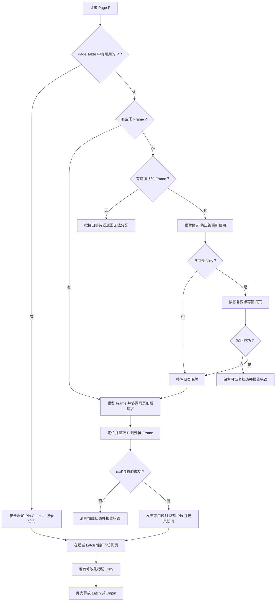
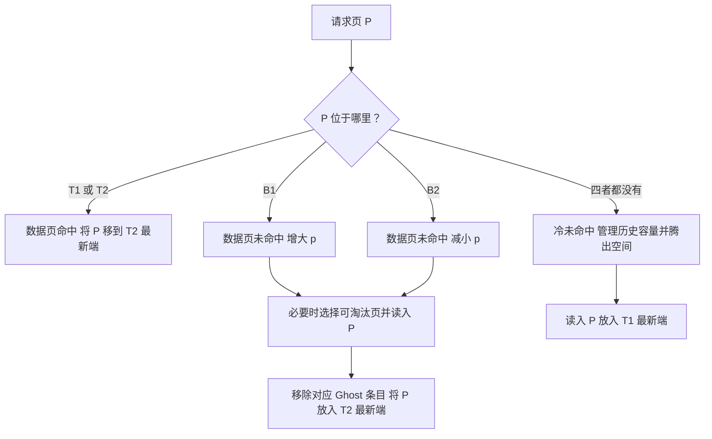

# 04 Buffer Pool：内存管理、页替换与 I/O

> 来源：[04-bufferpool.pdf](../slides/04-bufferpool.pdf)，Lecture #04，共 245 个实际 PDF 页面。
> 下文的“PDF 页”使用阅读器页码，不使用右上角幻灯片编号；重复动画页按主题合并。
> 课件原理与补充例子分开叙述。数值、操作序列及演示是教学设定；产品配置、操作系统行为和课程项目要求以所用版本为准。

## 0. 学习地图：上节解决“怎么放”，本节解决“什么时候搬”

读完 [03_storage1.md](./03_storage1.md)，应能沿着“文件 → 页 → 槽位 → Tuple → 字段”找到一行数据。本讲接着回答：**数据库大于内存时，怎样让需要的页及时可用，并安全地复用有限的内存？**

对应 PDF 页 2–18。

| 概念 | 关心的问题 | 与本讲的关系 |
| --- | --- | --- |
| 空间控制（Spatial Control） | 页写在哪里，相关页是否靠近？ | 上节的文件与页组织是基础 |
| 时间控制（Temporal Control） | 何时读入、保留、淘汰和写回页？ | 本节的主要任务 |

开始前只需理解：页是固定大小的数据块；磁盘 I/O 较贵；哈希表能按键查找；多个线程可以同时访问共享内存。不熟悉事务、WAL 或 B+ Tree 时，先掌握本讲中它们提供的必要背景即可。

建议按下面顺序学习，而不是一口气记下所有替换算法：

| 学习阶段 | 核心内容 | 学完应能完成 | PDF 页 |
| --- | --- | --- | --- |
| 1 | Frame、Page Table 与元数据 | 画出 Page ID 到内存页的映射 | 19–32 |
| 2 | Pin、Latch、Dirty 与取页流程 | 手推一次命中和一次脏页替换 | 22–32、173–174，流程为补充串联 |
| 3 | 为什么 DBMS 自己管理缓存 | 解释 mmap 与显式 Buffer Pool 的取舍 | 33–56 |
| 4 | LRU、Clock、LFU、LRU-K | 比较记录了哪些访问历史 | 57–106 |
| 5 | ARC、查询语义提示 | 手推四个列表和参数 p 的变化 | 107–172 |
| 6 | 写回、调度、OS 缓存与优化 | 区分命中率、等待时间和持久性 | 173–234 |

本讲还介绍 Project #1 的组件分工（PDF 页 236–245）。这里学习组件职责，不展开项目实现代码。

## 1. Buffer Pool 的结构：Page 与 Frame 分别是什么？

### 1.1 缓冲池是一组可以反复使用的页框

对应 PDF 页 19–21。

缓冲池（Buffer Pool）是 DBMS 管理的内存区域，组织成固定大小的页框（Frame）数组。读取一个数据库页时，将其内容放进一个 Frame。

- **Page** 是数据库中的数据单位，有 Page ID。
- **Frame** 是容纳页的内存位置，有 Frame ID。
- 同一个 Frame 可以先装 Page 10，淘汰后再装 Page 25；Frame ID 不随之变成 Page ID。

读取时，Frame 中得到该页的副本。之后如果修改内存页，它就可能与磁盘上的旧内容不同。Buffer Pool 通常是写回缓存（Write-back Cache）：修改不会每次都立即写到磁盘。

补充容量估算：若给页数据分配 1 GiB 内存、每页 4 KiB，理论上能容纳 `2^30 / 2^12 = 262,144` 个 Frame。Page Table、替换历史、同步对象等还要占内存，不能把这直接当作整个进程的内存需求。

### 1.2 Page Table：现在有哪些页在内存里？

对应 PDF 页 22–29。

缓冲池页表（Page Table）的基本映射是：

```text
Page ID → Frame ID → Frame 中的页字节
```

课件说 Page Table 通常使用哈希表，并用 Latch 保护并发访问。它是 DBMS 内部的数据结构，不是操作系统负责虚拟地址转换的页表。


图的静态读法：Page 10 在 Frame 0、Page 25 在 Frame 2；Frame 1 空闲。查找 Page 10 时，Page Table 直接给出 Frame 0。查找 Page 40 未命中时，才需要借助文件定位信息发起读取。

### 1.3 每个 Frame 附近还需要什么元数据？

| 信息 | 回答的问题 | 需要避免的误解 |
| --- | --- | --- |
| 当前 Page ID / 有效状态 | 这个 Frame 装的是谁？ | 空闲 Frame 没有有效数据页 |
| Dirty Flag | 页是否发生了尚需写回的修改？ | Dirty 不表示“正在使用” |
| Pin / Reference Counter | 多少使用者还持有该页？ | Pin 不表示“允许并发写” |
| Access Tracking | 最近何时用过、用过几次？ | 访问次数不等于当前 Pin 数 |
| I/O / 替换状态 | 是否正在加载、写回或被预留？ | 不能把未加载完成的 Frame 当作可读页 |

前三类及访问历史来自课件；显式 I/O 状态是理解并发实现的补充，不要求所有系统使用相同字段或存储位置。

### 1.4 Page Table、Page Directory、Slot Array 的分工

对应 PDF 页 32，并联系上一讲。

| 结构 | 输入 → 输出 | 主要生命周期 |
| --- | --- | --- |
| Page Directory / 文件定位元数据 | Page ID → 文件和位置 | 必须能在重启后恢复页的位置 |
| Buffer Pool Page Table | Page ID → 当前内存 Frame | 内存结构，重启后可重新建立 |
| Slot Array | 页内 Slot ID → Tuple 偏移 | 是数据页内容的一部分 |

**Page Table 未命中，只说明本缓冲池没有可直接使用的驻留页，不说明页不存在于数据库，也不说明下层 OS 缓存一定未命中。**

数据库还有排序、Join、查询缓存、维护任务、日志和字典等内存池（PDF 页 17）。它们不一定都有磁盘上的对应页，因此 Buffer Pool 不能代表 DBMS 使用的全部内存。

## 2. 先保证正确：Pin、Latch、Lock 与 Dirty

### 2.1 Pin 解决“这段内存还能不能被换成别的页？”

课件给出 Pin / Reference Counter；下面将其展开成使用过程。

使用者取得页时增加 Pin Count，用完后减少。最基本的安全条件是：

```text
pin_count > 0：不能将该页淘汰并复用其 Frame
pin_count = 0：可能进入可淘汰集合，但还要检查 I/O 和其他状态
```

例如，线程 T1 拿着 Frame 2 中 Page 25 的地址读取记录。如果此时 T2 把 Frame 2 换成 Page 40，T1 手里的指针仍然指向同一内存，却会读到另一页。Pin 用来阻止这种 Frame 复用。

**Unpin 不是淘汰。** Unpin 只是声明“我用完了”；页仍可留在池中，让下一次读取命中。忘记 Unpin 则可能使越来越多的 Frame 永远不能被替换。

### 2.2 Latch 解决“同时访问是否破坏内部结构？”

对应 PDF 页 30–31。

| 机制 | 保护对象 | 典型作用范围 |
| --- | --- | --- |
| Lock（事务锁） | 数据库的逻辑内容与事务隔离 | 由事务和隔离协议决定，可能持有至事务结束 |
| Latch（短期同步锁） | 页字节、Page Table 等内部结构 | 一次操作或临界区 |
| Pin | Frame 中当前页的驻留关系 | 使用者持有页的期间 |

课件用 Mutex 帮助理解 Latch。不要把“使用 Mutex”与“事务锁”按名字简单对应：关键是保护了什么、持有多久、提供什么保证。

补充例子：两个线程都 Pin 住 Page 25，只能说明该页不会被替换。若它们同时修改同一槽位，还需要页上的写 Latch 或其他正确的同步协议。事务隔离则属于更上一层的要求。

### 2.3 Dirty 解决“能否直接丢弃这份内存内容？”

对应 PDF 页 173–174。

- **Clean Page**：没有需要保存的未写回修改；若满足替换条件，可以直接丢弃内存副本。
- **Dirty Page**：有尚需写回的修改；复用 Frame 前必须先完成所需的写回与错误处理。

三种状态彼此独立：

| Pin Count | Dirty | 能否立即用于替换？ |
| --- | --- | --- |
| 大于 0 | 任意 | 不能，仍有人使用 |
| 0 | false | 若无 I/O、预留等限制，可以作为快速替换候选 |
| 0 | true | 可成为候选，但需先安全写回 |

所以，“最冷的页”“未被 Pin 的页”和“替换最便宜的页”不一定是同一页。

## 3. 串起来：一次 Fetch Page 怎样完成？

下面是结合课件结构的教学流程，不是 BusTub 某个 API 的实现规范。暂不展开具体 Latch 粒度、异步任务接口和事务协议。



如果无法渲染 Mermaid，可直接按这张路径表手推：

| 情况 | 路径 | 关键保证 |
| --- | --- | --- |
| 命中 | 查表 → Pin → 访问 → Unpin | 查到页与取得 Pin 之间不能被别人替换 |
| 未命中，有空闲 Frame | 预留 → 读入 → 发布 → 使用 | 加载完成前不能让别人读到半页 |
| 未命中，替换 Clean 页 | 预留候选 → 去掉旧映射 → 读入新页 | 旧页不能再被新的使用者取得 |
| 未命中，替换 Dirty 页 | 预留候选 → 安全写回 → 更新映射 → 读入新页 | 不能丢失旧页修改 |
| 所有页都被 Pin | 等待、失败或采取接口允许的措施 | 不能强行覆盖正在使用的页 |

并发实现还要协调两个线程同时请求同一未驻留页的情况，避免发布不一致的副本或重复占用 Frame。可以用加载状态等方式协调；不能把图中的“查表、Pin、淘汰、发布”当成彼此不受保护的普通语句。

补充理解：Page Guard 可用 RAII 将持有页、必要的 Latch 与释放行为封装起来，减少异常或提前返回时遗漏清理。具体 Guard 的职责以代码接口为准。

### 3.1 三个 Frame 的读写推演

假设只有 3 个 Frame，使用标准 LRU，表中队列按“最旧 → 最新”排列。为了隔离变量，每次访问结束立即 Unpin；只有“修改 A”会使页变脏，I/O 都成功。

| 操作后 | F0 | F1 | F2 | LRU 顺序 | 此步额外动作 |
| --- | --- | --- | --- | --- | --- |
| 读 A | A，Clean | 空 | 空 | A | 读入 A |
| 读 B | A，Clean | B，Clean | 空 | A, B | 读入 B |
| 修改 A | A，Dirty | B，Clean | 空 | B, A | 命中，标脏 |
| 读 C | A，Dirty | B，Clean | C，Clean | B, A, C | 读入 C |
| 读 D | A，Dirty | D，Clean | C，Clean | A, C, D | 淘汰 B，读入 D |
| 读 E | E，Clean | D，Clean | C，Clean | C, D, E | 先写回 A，再淘汰 A、读入 E |

这个模型共 6 次访问：1 次命中、5 次未命中、5 次页读取请求、1 次页写回。它描述 DBMS 的逻辑页 I/O，不等于设备命令数量，也不包含日志、目录、校验失败或后台写入。

若最后一次访问前 A 仍被 Pin，则不能因它最旧就淘汰它。正确性约束必须先于策略排序。

## 4. 为什么不直接交给 mmap？

对应 PDF 页 33–56。

内存映射文件（Memory-mapped File，mmap）把文件映射到进程虚拟地址空间。访问未驻留的数据时，OS 通过缺页处理将其调入。看起来可以用普通指针访问页，而不用自己管理 Buffer Pool。

问题是 OS 缺乏数据库语义：

| 课件指出的问题 | 对 DBMS 的影响 |
| --- | --- |
| Transaction Safety | OS 可能自行写回脏页，DBMS 仍要确保日志与数据的顺序 |
| I/O Stalls | 一次看似普通的内存访问可能触发缺页并阻塞线程 |
| Error Handling | 页面验证和 I/O 错误难以集中处理，访问可能触发 SIGBUS |
| Performance | OS 内部结构争用、TLB shootdown 等可能带来额外成本 |

增加线程可以隐藏部分等待，但没有解决写回顺序、错误处理和缓存决策的问题。

课件列出辅助系统调用：`madvise` 提供访问模式提示，`mlock` 尝试保持内存范围驻留，`msync` 用于同步映射范围。它们能处理部分需求，但仍要额外协调；本节不是这些调用的跨平台 API 使用指南。

本讲的设计结论是：**DBMS 往往有理由自己控制页读取、替换、写回和预取。** 不应从中推出 mmap 对所有系统都不适用，更不能把“用了 mmap”视为已经获得事务或持久性保证。

## 5. 替换策略：先筛选可淘汰页，再预测谁最不值得留下

对应 PDF 页 57。

策略需要同时考虑四个目标：正确性、预测准确性、执行速度、元数据开销。命中率更好的策略，如果每次访问都争用一个全局锁，也可能让系统变慢。

以下算法的“选择页”都默认只从满足替换条件的候选中进行。**访问历史只负责排序，不会取消 Pin 或 I/O 的保护。**

### 5.1 LRU：最久没访问的页先走

对应 PDF 页 58–62。

最近最少使用（Least Recently Used，LRU）记录每页最后一次访问时间，选择时间最旧者。也可维护有序链表，命中时移到最新端。

补充手推：容量 3，队列最旧 → 最新，访问 `A, B, C, A, D`：

```text
A       → [A]
B       → [A, B]
C       → [A, B, C]
A 命中  → [B, C, A]
D 未命中→ [C, A, D]，淘汰 B
```

使用哈希表与双向链表可让常见的查找、移动和移除操作平均为 O(1)，但高并发下维护顺序仍有同步与缓存一致性开销；如果被 Pin 的页也在链表中，寻找有效候选还可能需要跳过它们。

### 5.2 Clock：用访问位提供“第二次机会”

对应 PDF 页 63–76。

Clock 用循环排列的 Frame、一个时钟指针，以及每页的访问位（Access / Reference Bit）：

1. 页被访问时，将访问位置为 1。
2. 替换时，指针检查当前 Frame；不能淘汰的页跳过。
3. 若访问位为 1，清成 0，继续向前，给它一次机会。
4. 若访问位为 0，选择它作为候选；若是脏页，仍需先写回。

它近似 LRU，不维护完整的最近访问顺序。访问位 1 表示“自上次清零后被访问过”，不是累计访问次数，也不是 Pin Count。

#### 手推：Pin、访问位和 Dirty 如何共同影响替换？

补充模型：四个 Frame 按 `F0 → F1 → F2 → F3 → F0` 循环，指针初始指向 F0；请求新页 E。整个演示串行执行，被选中 Frame 在 I/O 期间会被预留。

| 初始 Frame | 页 | Pin | 访问位 | Dirty |
| --- | --- | --- | --- | --- |
| F0 | A | 1 | 0 | false |
| F1 | B | 0 | 1 | false |
| F2 | C | 0 | 0 | true |
| F3 | D | 0 | 1 | false |

| 步骤 | 动作 | 原因或结果 |
| --- | --- | --- |
| 1 | 跳过 F0 | A 的 Pin=1；即使访问位为 0，也不能替换 |
| 2 | 将 F1 的访问位从 1 清成 0 | B 得到第二次机会，指针继续 |
| 3 | 选择并预留 F2 | C 的 Pin=0、访问位=0，是合法候选 |
| 4 | 写回 C | Dirty=true，不能直接丢弃其修改 |
| 5 | 移除 C 的映射，读入 E | 复用 F2；E 的 Pin=1、访问位=1、Dirty=false；指针移到 F3 |
| 6 | 使用者释放 E | Pin 从 1 到 0，E 仍留在 F2 |

[打开 Clock 与页替换逐步演示](./demos/04-clock.html)。先预测每次指针移动会做什么，再点击下一步；可后退和重置。正文表格包含同样的推演。

Clock 并非每次淘汰严格 O(1)：若许多位都是 1，可能要扫一圈；若所有 Frame 都不可淘汰，不能无限循环等待“自然找到”候选，必须按系统接口处理无候选的情况。

### 5.3 Sequential Flooding：刚访问过，不等于值得保留

对应 PDF 页 77–86。

顺序扫描污染（Sequential Flooding）指大量一次性访问的页进入缓存，挤走原本会被重复使用的热页。

补充例子：容量 3，起初有热页 H；一个扫描连续读取 `S1, S2, S3, S4`，之后再次请求 H。LRU 只看最近访问，H 会被逐渐挤走，最后一次访问 H 又要读取。

更极端地，循环读取 `A, B, C, D`，但容量只有 3。在标准 LRU 下，每轮再次访问一个页前，它往往刚被其他页挤掉，因此在这个确定序列中每次访问都未命中。

课件说某些 OLAP 扫描中最近使用的页可能最适合淘汰，因为它已经完成了本轮使命。这不表示所有 OLAP 场景都应该改用 MRU；要结合访问模式判断。

### 5.4 LFU：频率有帮助，旧热点也可能占住空间

对应 PDF 页 87–88。

最不经常使用（Least Frequently Used，LFU）按访问次数选择低频页，能保留频繁访问的页。但累计计数忽略时间：昨天访问一万次、今天不再使用的页，可能长期挤占当前有价值的页。

课件还指出有序维护访问计数的实现成本；例如使用堆时，更新可为 O(log N)。这是实现选择带来的成本，不意味着所有 LFU 变体都有相同复杂度。

### 5.5 LRU-K：观察第 K 次最近访问，而不是只看最后一次

对应 PDF 页 89–106。

LRU-K 为每页维护最近 K 次访问时间。设当前时间为 t，第 K 次最近访问时刻为 `tK`，向后 K 距离（Backward K-distance）为：

```text
backward_k_distance = t - tK
```

优先淘汰距离最大的页。若不足 K 次历史，课件示例将距离视为 ∞；多个 ∞ 用已有历史中最早的访问时间打破平局。

**复现课件的 K=2 例子，PDF 页 94–98：** 在 t=5 请求一个新页，现有页历史如下，所有页均可淘汰：

| 页 | 最近一次访问 | 倒数第二次访问 | Backward 2-distance |
| --- | --- | --- | --- |
| page0 | 4 | 1 | `5 - 1 = 4` |
| page1 | 2 | 无 | ∞ |
| page2 | 3 | 无 | ∞ |

LRU 会选最后访问时间最旧的 page1；LRU-2 在这里也选 page1，但理由是它缺少重复访问证据，并在两个 ∞ 中更早被访问。

为了看出差异，再看一个补充例子：A 的历史为 `[1, 4]`，B 为 `[2, 3]`，当前 t=5。LRU 选 B，因为 B 最后一次访问更早；LRU-2 选 A，因为 `5-1 > 5-2`。

课件还提到为近期淘汰页保留 Ghost History，避免页重新载入时总被视为毫无历史的新页。历史只保存访问记录，不保存完整页字节，且需要限制占用。

## 6. ARC：用淘汰后的再访问，调节近期性与重复访问之间的倾向

对应 PDF 页 107–162，是本讲的另一处重点。

自适应替换缓存（Adaptive Replacement Cache，ARC）的问题是：**近期第一次访问的页，与已有重复访问证据的页，分别应该分到多少空间？**

### 6.1 四个列表各保存什么？

| 列表 | 代表的类别 | 对应页数据是否驻留？ |
| --- | --- | --- |
| T1 | 近期进入、尚未晋升到 T2 的页 | 是 |
| T2 | 已有重复访问证据的页 | 是 |
| B1 | 最近从 T1 淘汰的页的历史标识 | 否 |
| B2 | 最近从 T2 淘汰的页的历史标识 | 否 |

四个列表可只保存 Page ID；真正的数据字节在 Frame 中。T1、T2 的条目关联驻留页，而 Ghost Lists B1、B2 仅保存“曾经缓存过谁”的信息。

课件将 T2 称为 MFU List，但不能把它理解成普通 LFU 的累计计数排序；ARC 会在列表内部维护新旧次序。

设数据页容量为 C，目标参数为 p，则课件给出：

```text
|T1| + |T2| ≤ C
|T1| + |T2| + |B1| + |B2| ≤ 2C
0 ≤ p ≤ C
```

前两项是驻留页与历史条目的数量约束；`2C` 不表示保存了两倍容量的数据页，Ghost 条目消耗的是额外元数据内存。

### 6.2 p 是目标，不是硬切分

p 是 T1 的目标大小，C-p 是 T2 的对应目标：

- p 增大：相对偏向给近期页更多空间。
- p 减小：相对偏向保留有重复访问证据的页。

实际列表长度不必时时等于目标。比如初始 p=0，新页依然可以进入 T1；p 在需要替换时影响选择倾向，而不是“禁止 T1 保存任何页”。

### 6.3 一次请求的四类情况



不支持 Mermaid 时，按以下规则理解即可：

| 请求类型 | 学到的反馈 | 操作方向 |
| --- | --- | --- |
| T1 / T2 命中 | 页确实得到再次访问 | 转入或更新 T2 的最新端 |
| B1 命中 | 刚从近期页集合淘汰，就又被访问 | 增大 p，重新读入后进入 T2 |
| B2 命中 | 重复访问页集合中的页被淘汰过早 | 减小 p，重新读入后进入 T2 |
| 完全新页 | 只有第一次访问证据 | 必要时腾位置，进入 T1 |

**Ghost 命中仍然是数据缓存未命中，需要取得页数据。** 它的价值在于提供反馈，并不直接返回记录。

若 B1 命中，为什么增大 T1 的目标，却把这次读入的页放入 T2？因为这是两件事：p 调整后续的容量分配倾向；当前页已经被再次访问，应该进入有重复访问证据的集合。

### 6.4 一个完整的小序列

补充手推：C=3，初始 p=0，四个列表均空；请求 `A, B, C, A, D, B, E, C, A`。各列表统一按“最旧 → 最新”书写，所有页均可淘汰、I/O 成功。

本例的 Ghost 命中调整量均为 1；这是该序列的数值，不将其推广为所有 ARC 变体的固定步长。表中给出每次请求完成后的稳定状态。

| 请求 | 结果与动作 | p | T1 | T2 | B1 | B2 |
| --- | --- | --- | --- | --- | --- | --- |
| A | 冷未命中 | 0 | A | 空 | 空 | 空 |
| B | 冷未命中 | 0 | A, B | 空 | 空 | 空 |
| C | 冷未命中 | 0 | A, B, C | 空 | 空 | 空 |
| A | T1 命中，晋升 | 0 | B, C | A | 空 | 空 |
| D | 冷未命中，B 从 T1 淘汰 | 0 | C, D | A | B | 空 |
| B | B1 命中，p 增加；C 淘汰 | 1 | D | A, B | C | 空 |
| E | 冷未命中，A 从 T2 淘汰 | 1 | D, E | B | C | A |
| C | B1 命中，p 增加；B 淘汰 | 2 | D, E | C | 空 | A, B |
| A | B2 命中，p 减少；D 淘汰 | 1 | E | C, A | D | B |

重点看后三行：p 从 1 到 2 再到 1，反馈来自不同 Ghost 列表；同一系统不必永远固定偏向近期性或重复访问。

### 6.5 冷未命中时，历史本身也要回收

课件 PDF 页 158–162 还展开了冷未命中的容量处理。按其教学规则理解：

- 当 `|T1| + |B1| = C`，需要控制近期部分的条目数量：若 T1 已占满 C，可直接从 T1 淘汰并丢弃相应历史；否则先丢弃 B1 的旧历史，再按替换规则腾驻留空间。
- 当 `|T1| + |B1| < C` 且四列表总量已达到 C，可能需要腾驻留空间；若总量达到 2C，还要先丢弃 B2 中的旧历史。
- 新页最终进入 T1。T1 过于偏大时倾向从 T1 淘汰，否则从 T2 腾空间，并在适用时留下 Ghost 标识。

这些规则说明 **ARC 连“最近淘汰过谁”的历史也有预算**。课件不是完整的并发实现规格：精确的 p 调整幅度、边界平局、Pinned 页处理及错误路径，应在实现时对照指定算法与项目接口，不能只把这份概念笔记翻译成代码。

### 6.6 五种策略放在一起比较

| 策略 | 主要历史信息 | 有利之处 | 主要代价或弱点 |
| --- | --- | --- | --- |
| LRU | 最近一次访问或全局新旧顺序 | 直观，能利用时间局部性 | 易受顺序扫描污染；维护顺序有开销 |
| Clock | 访问位和循环指针 | 命中路径更新较轻 | 近似排序，淘汰时可能扫描多个 Frame |
| LFU | 访问计数 | 能识别高频页 | 老热点可能长期占空间 |
| LRU-K | 最近 K 次时间及可选 Ghost 历史 | 能区分一次性和重复访问 | 历史与候选排序更复杂 |
| ARC | 两类驻留列表、两类 Ghost 列表与 p | 根据淘汰反馈自适应调整 | 状态转移和历史回收更复杂 |

不要仅按算法名称判断实际性能；还要观察同步成本、元数据大小、候选是否被 Pin，以及负载是否变化。

## 7. 利用查询语义：DBMS 比通用缓存多知道什么？

对应 PDF 页 163–172。

### 7.1 Localization：限制一个查询的污染范围

查询可能知道自己只是顺序扫一遍数据，可以在有限的缓存区域中循环复用页，避免挤掉整个系统的热集。课件以 PostgreSQL 的有限缓冲环说明这一思想。

“给扫描限制一组 Buffer”不等于每个查询都获得一份永久独占的完整 Buffer Pool；应区分替换影响范围与物理内存分区。

### 7.2 Priority Hints：同一棵树，不同位置也可能有不同价值

执行引擎知道页属于索引还是表、处于怎样的访问路径。例如索引高层节点往往服务多次查找，可以提示较高优先级；只用一次的扫描页可降低保留倾向。

课件还用递增 key 的插入路径说明：频繁触及的索引分支与当前工作负载相关，不能把“树上的某个位置永远最重要”写死。

提示只能改善预测，不能取消 Pin、同步或恢复要求。

## 8. Dirty Page：写回与淘汰是两个动作

对应 PDF 页 173–174。

替换 Clean 页可以直接丢弃；替换 Dirty 页则可能使前台请求先等待写回，再等待新页读取。为了减少这种长尾等待，DBMS 可让后台线程提前清理脏页，称为 Background Writing、Page Cleaning 或 Buffer Flushing。

```text
脏页安全写回 → 留在 Buffer Pool，成为干净页
脏页安全写回 → 随后淘汰并复用 Frame
```

**Flush 不必 Evict；Evict 也不必 Flush——后者只在页本来是 Clean 等满足条件时成立。**

### 8.1 为什么不能写完就随手清掉 Dirty？

补充并发例子：后台线程写出版本 V1；另一个线程同时将内存页改成 V2。如果写回完成时无条件把 Dirty 清零，V2 就可能被误认为已经写回。实现需要同步、版本标记或其他协议，确认清理的是哪一批修改。

Pin 的主要作用是禁止替换，不自动意味着“任何刷盘都不允许”；能否刷一个正在使用的页，还取决于同步方式与数据一致性协议。

### 8.2 日志与数据的顺序

课件提醒：不能在对应日志写入之前就随意写出脏数据页。对采用写前日志（Write-ahead Logging，WAL）的恢复协议，必须遵守其日志先行的持久化约束。

这只是恢复知识的入口：本讲不要求掌握完整的提交协议，也不能把“数据页已写回”或“数据页仍是 Dirty”直接等同于事务是否提交。

## 9. Disk I/O Scheduling：不仅要少读，还要让重要请求先完成

对应 PDF 页 175–176。

OS 与硬件会批量处理或重排请求以提高带宽；但它们不知道请求对应哪个查询、是否卡住用户响应、是否有 SLA。

DBMS 可以维护内部 I/O 队列，考虑：

- 顺序 / 随机访问，以及是否便于合并。
- 前台关键路径 / 后台清理。
- 表、索引、日志或临时数据。
- 事务状态和用户延迟目标。

例如，缺少某个页使查询完全无法推进，而另一请求只是提前清理暂时不急需的脏页。两个请求字节数相同，但优先级未必相同；反过来，长期饿死后台写回，也会使后续前台请求突然付出更大的代价。

**异步 I/O 将提交与完成分开，不代表 I/O 已经完成或永远无需等待。** 读入期间必须保护目标 Frame 的内存生命周期，完成时再唤醒等待者。

课件提到某些系统建议使用特定 Linux I/O 调度器。这里记录其设计动机，不将课件中的调度器名称作为当前机器的通用调参建议。

## 10. OS Page Cache 与持久性边界

对应 PDF 页 177–188。

### 10.1 两级缓存为什么可能重复？

```text
普通缓冲文件 I/O：
DBMS Buffer Pool（用户态） → OS Page Cache（内核态） → 文件系统 / 存储设备

Direct I/O 的设计意图：
DBMS Buffer Pool → 尽量绕过文件数据的 OS Page Cache → 存储路径
```

同一数据可能在 DBMS 和 OS 各缓存一份，造成冗余、两套淘汰策略和更难预测的 I/O 行为。课件因此介绍 Direct I/O（例如 Linux 的 `O_DIRECT`）。

注意三点：

1. DBMS Buffer Pool 未命中后，下层 OS 缓存仍可能命中，所以一次页读取请求不一定产生设备读取。
2. Direct I/O 不是绕过所有内核工作，也不能仅因采用它就推导出数据已持久化。
3. 是否使用 Direct I/O、如何对齐以及如何同步，是具体系统与平台的选择，本讲不统一规定。

### 10.2 write 成功、同步成功与故障后可恢复

按常见缓冲文件 I/O 的概念路径理解：

| 事件 | 能说明什么 | 不能单独推出什么 |
| --- | --- | --- |
| 修改内存页 | 进程内数据变化 | 已写入存储 |
| `write` 返回成功 | 这次调用按返回值接收了相应字节，可能只进入 OS 缓存 | 断电后一定存在 |
| 同步操作成功 | 在对应平台与存储栈的约定下完成同步要求 | 整个事务协议和所有相关文件都正确 |
| DBMS 按完整恢复协议报告成功 | 满足该系统承诺的提交与恢复条件 | 能抵御协议未覆盖的所有故障 |

课件的 `fsync` 故障案例强调：**一次同步失败后，不能仅因重试返回成功，就认定前一次失败的数据已经安全写入。** 错误状态的记录、重试和恢复都要有明确协议。

其中“Linux 将脏页标为干净”的叙述属于课件案例，应结合其内核、文件系统和故障条件理解，不作为所有环境的统一行为保证。

## 11. 四类优化：分别减少什么成本？

对应 PDF 页 189–233。

### 11.1 Multiple Buffer Pools：拆分共享热点

可按实例、数据库或页类型分成多个 Pool；也可通过对象标识或 Page ID 的哈希选择目标 Pool。

它减少 Page Table、LRU 等共享元数据上的 Latch 竞争，并改善局部性。补充取舍是容量可能不均衡：一个 Pool 很忙，另一个仍有空闲，所以分片不意味着性能必然按数量线性提升。

### 11.2 Pre-fetching：在真正需要之前读入

顺序扫描可提前读接下来要处理的页；索引访问可利用查询计划和键范围预测候选页。逻辑上相邻的索引页不一定在磁盘上连续，不能把索引预取简单当作连续文件读取。

理想效果是用当前页的处理时间覆盖下一页的部分 I/O 等待。预取太少可能来不及，太多则消耗带宽和缓存；预取还不等于这些页已被查询实际使用。

### 11.3 Scan Sharing：共享读取过程，不共享最终结果

多个查询可协调扫描同一张表，称为同步扫描（Synchronized Scans）。按课件动画，Q1 已扫过 page0–page2，Q2 可以从 page3 跟随读取到末尾，再绕回读取 page0–page2：

| 查询 | 逻辑覆盖范围 | 一种可能的扫描顺序 |
| --- | --- | --- |
| Q1：SUM | 全表 | 0, 1, 2, 3, 4, 5 |
| Q2：AVG，稍后加入 | 全表 | 3, 4, 5, 0, 1, 2 |

共享的是页读取及可利用的驻留数据，各自仍执行自己的聚合与可见性判断。这不同于 Result Cache；扫描共享也不能保证在所有实现中每页恰好只读一次。

只有查询语义允许这种遍历顺序时才可采用。涉及顺序要求、提前停止或不同快照时，需要由执行器与可见性机制正确处理，不能为了共享漏掉或重复处理记录。

### 11.4 Buffer Pool Bypass：一次性数据少占公共热集

大规模顺序扫描可把读取的页放在查询局部内存中，而不插入常规共享 Buffer Pool；排序、Join 等临时数据也可采用类似思路。

它避免公共缓存污染和部分元数据开销，但并不等于不使用内存、不经过 OS，或不需要 I/O。查询仍需要保存和处理当前输入。

四类优化可以这样区分：

| 方法 | 主要减少的成本 | 可能增加的代价 |
| --- | --- | --- |
| 多个 Pool | 共享元数据争用 | 容量不均衡、路由复杂度 |
| 预取 | 需求访问时的等待 | 无用读取、带宽和缓存占用 |
| 扫描共享 | 多查询重复读取 | 协调、进度和语义处理 |
| Bypass | 缓存污染和管理开销 | 需要局部缓冲，减少共享复用机会 |

## 12. 将知识对应到实现组件

对应 PDF 页 236–241，只概括课件中的职责，不提供项目答案。

| 组件 | 负责什么 | 不应混淆成什么 |
| --- | --- | --- |
| Replacer | 跟踪访问，管理可淘汰集合，选择候选 | 不负责读写页内容，也不能忽略 Pin |
| Disk Scheduler | 接收、排队、提交读写请求并通知完成 | 请求入队不等于已完成 |
| Buffer Pool Manager | 协调 Page Table、空闲 Frame、Pin、Dirty、替换与 I/O | 不能只靠一个替换算法完成全部职责 |
| Page Guard | 按接口管理持有与释放行为 | 不自动提供事务隔离或持久性 |

课件的项目版本采用 ARC，并介绍后台 worker 和 `std::promise` 完成通知。其他课程年份的项目可能不同，学习概念时不要混用接口或要求。

阅读未来的代码时，先沿三个场景追踪：命中并释放页、未命中替换脏页、所有 Frame 不可淘汰。逐步记录谁持有 Frame、谁修改 Page Table、何时发布 I/O 完成。

## 13. 自测：先手推，再打开答案

1. Page ID、Frame ID 和内存地址为什么不能互换？
2. Page Table 未命中是否意味着设备必须读取一次？
3. 为什么 `pin_count=0` 不能等同于“该 Frame 已空闲”？
4. 两个线程都 Pin 住同一页，能否因此安全地同时修改它？
5. Dirty 页写回后是否必须淘汰？Unpin 后是否必须写回？
6. 三个 Frame 都被 Pin 时，新页未命中应如何处理？
7. 按 §5.2 的 Clock 初始状态，为什么不选 F0，为什么不能直接覆盖 F2？
8. K=2、t=10，A 的历史为 `[2,9]`，B 为 `[4,8]`，C 只有 `[7]`。所有页可淘汰时，先选谁？去掉 C 后，LRU 与 LRU-2 分别选谁？
9. ARC 的 B1 命中是否能直接返回页？为什么 p 增大，但该页进入 T2？
10. ARC 中 C=100，四列表最多合计 200 个条目，是否表示最多占用 200 个数据 Frame？
11. 顺序扫描怎样污染热集？预取、扫描共享和 Bypass 分别缓解哪一种问题？
12. `write` 成功后，为什么不能直接向上层推导“事务已经持久提交”？

<details>
<summary>参考答案</summary>

1. Page ID 标识数据库页；Frame ID 标识可复用的内存容器；内存地址访问当前字节。淘汰复用后，同一 Frame 和地址可以装另一页。
2. 不一定。可能命中 OS Page Cache；请求还可能涉及目录等额外读取，设备 I/O 计数不能直接由该次未命中推出。
3. 它只是没有当前使用者；页仍驻留，可能很热、很脏，或受 I/O 等状态限制。
4. 不能。Pin 防止替换，页内容并发访问仍需要 Latch 或其他同步协议。
5. 都不必然。安全写回后可以保留干净页；Unpin 只是释放使用权，不等于刷盘触发器。
6. 按接口等待、失败或采取其他允许的资源处理；不能覆盖被使用的 Frame。
7. F0 的 Pin=1。F2 虽然可选，但包含未写回修改，需要先预留并安全写回，再复用。
8. C 的 K 距离为 ∞，先选 C。去掉 C 后，LRU 选 B（最近一次为 8）；LRU-2 选 A（10-2=8，大于 B 的 10-4=6）。
9. 不能，B1 只有历史标识。p 增大反馈的是容量倾向；当前页已被重复访问，归入 T2。
10. 不是。T1+T2 的数据页最多占 100 个 Frame，B1/B2 是额外的历史元数据。
11. 一次性页挤走热页。预取主要隐藏需求等待，扫描共享协调重复读取，Bypass 避免一次性页进入公共热集；它们可以组合，但职责不同。
12. 字节可能只进入 OS 缓存；还需满足同步、日志顺序、提交和错误处理等完整协议。

</details>

## 14. 复习时画出这条链

```text
Page ID
  → Page Table 查找
  → 命中：安全 Pin 后使用
  → 未命中：找空闲或可淘汰 Frame
       → 脏候选先按恢复要求写回
       → 读入并发布新页
  → Latch 保护必要的访问，修改则标脏
  → 用完 Unpin，等待未来命中或替换
```

用三句话检查理解：**Pin 保证驻留，Latch 保护访问，Dirty 记录写回需求。替换策略预测保留价值，查询语义还能提供额外提示。命中率、I/O 等待和持久性是三个不同维度。**

下一步阅读 [05-storage2.pdf](../slides/05-storage2.pdf)，回到 Log-structured、Index-organized 等存储组织方式。可以继续追问：当文件组织改变时，读写的页、块与缓存对象也会怎样变化？
