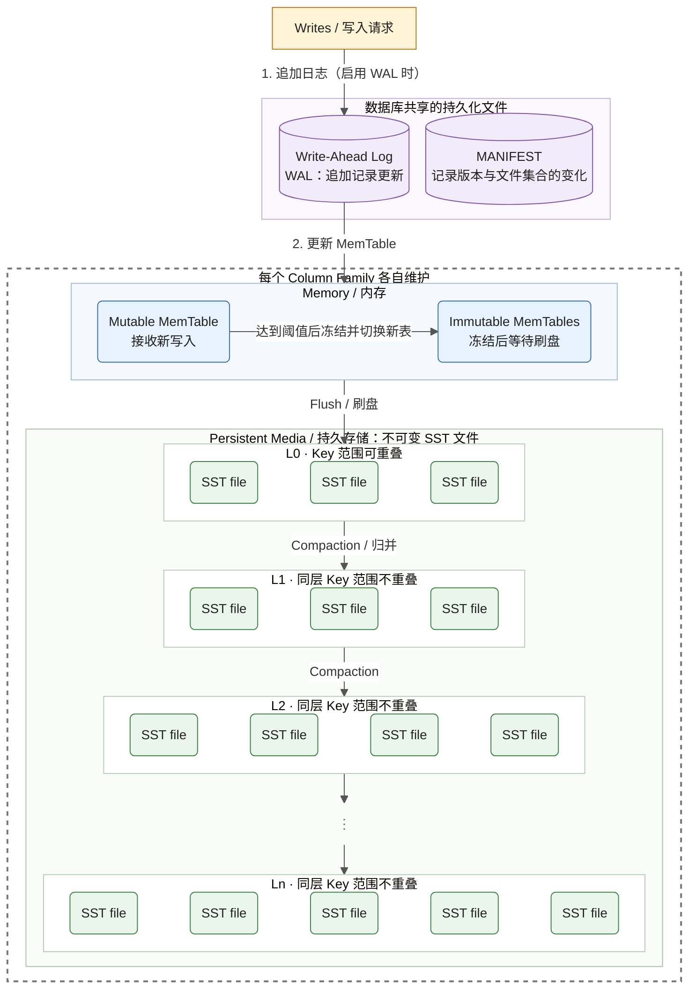

理解角度：
- 数据库整体管理
- 内存结构
- 磁盘结构
- 读写流程
- 后台任务

核心观点：**RocksDB 不只是一个 LSM-Tree，而是一个围绕 LSM-Tree 构建的完整嵌入式存储引擎。**

## 写入与存储结构

下面按 [参考图](https://user-images.githubusercontent.com/62277872/119747261-310fb300-be47-11eb-92c3-c11719fa8a0c.png) 重绘，展示典型的 **Leveled Compaction** 结构。箭头表示数据流或元数据关系，不表示文件的物理排列。

- **WAL 与 MemTable**：正常启用 WAL 的写入先记录日志，再更新 MemTable；同步写还会在返回成功前等待 WAL 持久化。WAL 由多个 Column Family 共享。
- **Flush**：MemTable 冻结后不再接收更新，后台将其刷成 SST；新的写入由新的 Mutable MemTable 接收。
- **Compaction**：读取输入 SST 并生成新 SST，而不是修改已有文件；只有不再需要的旧版本和删除标记才可被清理。图中连线只示意层间流向，实际一次合并可能涉及多个文件。
- **层级范围**：L1 到 Ln 的“不重叠”指同一层内不同文件的 Key 范围；不同层之间仍可能重叠。
- **MANIFEST**：记录恢复 SST 文件集合与层级版本所需的元数据；尚未刷盘的更新由 WAL 重放恢复。

