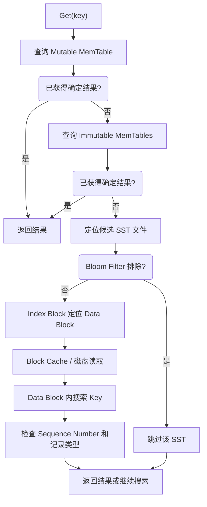
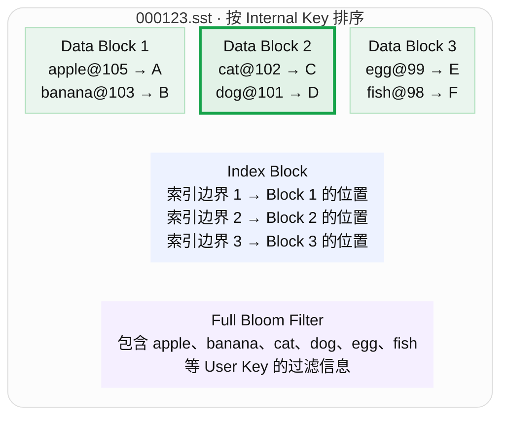
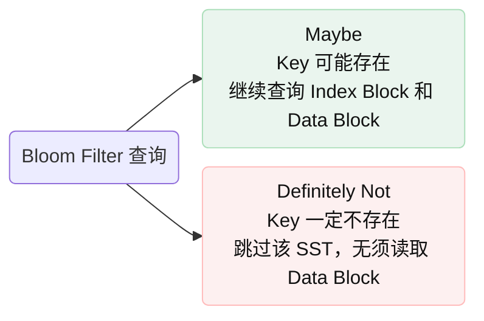
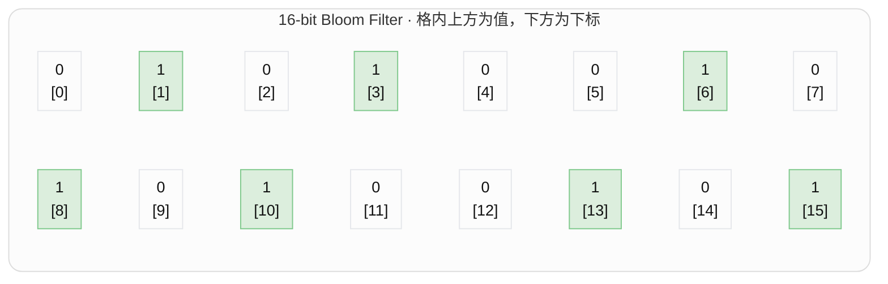
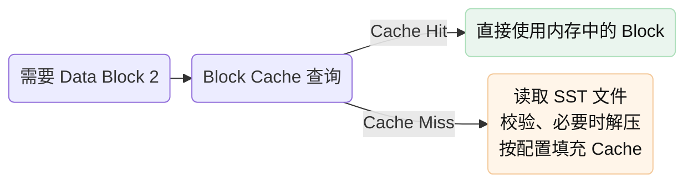
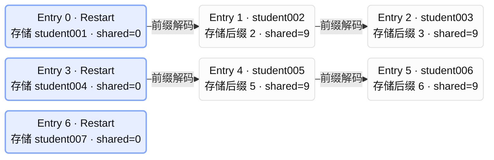

# 一次 point lookup 会经历什么？

## 流程

Full Bloom Filter 的 SST，典型的点查询逻辑是：



## 二、通过一个具体例子理解查询

假设执行：
```
std::string value;

db->Get(
    rocksdb::ReadOptions(),
    "cat",
    &value
);
```

我们假设：
1. Mutable 和 Immutable MemTable 都没有 cat。
2. RocksDB 找到了一个可能包含 cat 的 SST。
3. 该 SST 配置了 Full Bloom Filter。
SST 内包含以下记录：



图中 `key@seq` 表示 User Key 与 Sequence Number；绿色加粗框标出本例查询 `cat` 的目标数据块。此图展示逻辑组成，省略其他元数据和 Footer，不表示文件中的物理排列顺序。

下面正式开始查询。

### **Step 1：找到候选 SST 文件**

在调用 SST 内部的 Index Block 之前，RocksDB 必须先知道：

应该去哪个 SST 文件查找？

RocksDB 使用 LSM-Tree 的 Version 元数据，维护每个 SST 文件的 Key 范围。

例如：
```
SST	所在 Level	User Key 范围
000121.sst	L0	apple – dog
000122.sst	L0	banana – fish
000123.sst	L0	apple – fish
000098.sst	L1	apple – mango
```

由于 cat 落在多个文件的 Key 范围内，可能需要检查多个文件。

其中：
- L0 的 SST 文件允许 Key 范围重叠，因此一个 Key 可能对应多个候选文件。
- L1 及更深层级在通常的 Leveled Compaction 下，同一层的 SST Key 范围互不重叠，所以每层至多定位到一个候选文件。

这一步使用的是 SST 文件级别的元数据，还没有进入某个 SST 文件内部的 Data Block。

### **Step 2：Bloom Filter 判断 Key 是否可能存在**

假设现在检查 000123.sst。

Bloom Filter 会对 cat 做成员查询：
$$
\operatorname{MayContain}(\text{"cat"})
$$

可能得到两种结果。




Bloom Filter 内部到底在做什么？
假设有一个 16-bit 的 Bloom Filter：




教学示例，真实 Bloom Filter 通常更大，并使用专门的哈希计算。
写入时，对某个 Key 使用多个哈希函数：
$$
h_1(k),h_2(k),\ldots,h_r(k)
$$

对应的 Bit 被设置为 1。

查询时，再计算这些哈希位置：
- 只要有一个 Bit 是 0，就能确定 Key 不存在。
- 如果全部是 1，也不能保证 Key 存在，因为可能是其他 Key 共同设置了这些 Bit。
这就是 Bloom Filter 存在 False Positive（假阳性），却不会正常产生 False Negative（假阴性）的原因。

理解重点：Bloom Filter 不是寻找 Key 的具体位置，而是提前判断有没有必要继续寻找。


### **Step 3：Index Block 定位 Data Block**

假设 Bloom Filter 返回 Maybe。

现在 RocksDB 需要知道 cat 究竟在哪一个 Data Block 中。

Index Block 通常保存有序的索引 Key 和 BlockHandle。

对于刚才的 SST，我们可以把 Index Block 简化理解为：

|索引覆盖范围（示意）|BlockHandle|
|---|---|
|apple – banana|(offset=0, size=4096)|
|cat – dog|(offset=4101, size=4096)|
|egg – fish|(offset=8202, size=4096)|

这张表只是帮助理解查找关系。真实 Index Key 通常是根据相邻 Data Block 的边界构造的分隔 Key，不一定直接存储这样的起止范围。

RocksDB 在 Index Block 中搜索 cat，最终定位：
$$
\boxed{\text{BlockHandle}=(4101,4096)}
$$

表示：
- Data Block 位于文件偏移 4101 字节处。
- 其大小为 4096 字节。
这是一个关键区别：

Index Block 定位的是 Data Block，并不是直接定位到其中某条 Key-Value 的字节地址。

因此，它通常还需要在目标 Data Block 内执行一次查找。

### **Step 4：先检查 Block Cache**

得到了 BlockHandle，是否就需要读取磁盘？

不一定。

RocksDB 会尝试从 Block Cache 中获取对应的数据块。



这里可以联系你之前学习的 CMU 15-445 Buffer Pool。

相似之处在于：
- 都避免反复从磁盘读取相同的数据。
- 都有 Cache Hit 和 Cache Miss。
- 都需要内存淘汰策略。
但 RocksDB 的 Block Cache 主要缓存 SST Block，不等同于传统 DBMS 对可修改 Page 的缓存。

### **Step 5：在 Data Block 内查找 Key**

现在已经拿到 Data Block 2：
(cat, 102) → C
(dog, 101) → D


如何快速找到 cat？

这里就要用到你前面看到的两个概念：
- Prefix Compression
- Restart Point

#### **5.1 为什么引入 Prefix Compression？**

考虑下面几个 Key：
```
student001
student002
student003
student004
student005
```

如果每次都完整存储，就有大量重复的前缀。

例如 student001 和 student002 共有 9 个字节。

RocksDB 可以编码为：
|Key|Shared Bytes|Key Delta|
|---|---|---|
|student001|0|student001|
|student002|9|2|
|student003|9|3|
|student004|9|4|
|student005|9|5|

这样可以显著节省空间。

但同时出现一个新问题：

如果后一个 Key 依赖前一个 Key 才能解码，还怎么进行二分查找？

这就是 Restart Point 的设计动机。

#### **5.2 Restart Point 如何解决这个问题？**

RocksDB 每隔一定数量的 Entry 设置一个 Restart Point。

在 Restart Point 上：
$$
\text{shared\_bytes}=0
$$

意味着该 Key 需要完整存储，不依赖之前的 Key。

例如假设 Restart Interval = 3：



蓝色节点是独立解码的重启点；箭头表示后一条记录需要前一条记录的完整 Key 才能还原。`shared` 表示与前一条 Key 共享的前缀字节数，此例共享前缀为 `student00`（9 字节）。图中省略 Value 和其他编码字段。

这样 RocksDB 就可以先对 Restart Point 对应的完整 Key 进行二分查找。

假设寻找：

student005

过程为：
1. 对 student001、student004、student007 这几个 Restart Key 进行二分搜索。
2. 确定目标位于以 student004 开始的区间。
3. 从 student004 开始逐条解码。
4. 解码 student005，完成匹配。

因此，Data Block 内部不是对所有压缩记录直接进行普通二分搜索，而是通常采用：

Restart Points 上的二分查找 + 区间内的顺序扫描。

这也是为什么 Restart Point 可以同时兼顾压缩率与查询效率。

## 三、找到 Key 后，为什么还要检查 Sequence Number？

到这里，我们成功在 SST 内定位了 cat。

但是，RocksDB 还不能完全忽略 Internal Key 中的其他字段。

假设某个 SST 中有：
```
(cat, 120, Value) → "new"
(cat, 100, Value) → "old"
(cat, 90, Value)  → "older"
```

如果执行普通的最新版本读取，通常应该得到：new

但是，如果使用 Snapshot 呢？

假设快照对应：
$$
\text{Snapshot Sequence Number}=110
$$

此时：

|Internal Key|对 Snapshot 110 是否可见|
|---|---|
|cat@120|不可见|
|cat@100|可见|
|cat@90|可见，但较旧|

最终返回：old

也就是说，在普通的版本记录模型中，RocksDB 寻找满足
$$
\boxed{\text{SequenceNumber}\leq\text{SnapshotSequenceNumber}}
$$
的最新可见版本。

如果遇到的是可见的 Delete Tombstone，则表示该 Key 在该读取视图中已被删除，不能简单地忽略 Tombstone 并返回更旧的 Value。

此外，如果一个 SST 中没有足够的信息完成读取，RocksDB 可能需要继续检查其他 SST。

这正是 RocksDB 的多版本读取与 LSM-Tree 多层存储之间的重要联系。

## 四、一次 Get() 的成本究竟来自哪里？

这部分建议重点掌握，因为你后续学习 CacheLib 和 Kangaroo 时也会再次遇到。

|操作|可能的开销|对应优化|
|---|---|---|
|查找候选 SST|CPU、元数据访问|Level 文件范围索引|
|Bloom Filter|哈希计算、内存访问|快速排除不存在的 Key|
|Index Block 查询|比较、索引块读取|Index Cache、分区 Index|
|Data Block 读取|磁盘 I/O|Block Cache、预取|
|Block 解压|CPU|压缩算法选择|
|Data Block 内查找|CPU、Key 解码|Restart Point、Data Block Hash Index|
|多个 SST 查询|CPU、I/O|Compaction 减少重叠和文件数|

可以观察到三个不同层次的优化：
- Bloom Filter：减少不必要的查找和 I/O。
- Index Block：缩小查询范围，定位目标 Data Block。
- Block Cache：避免重复读取已经访问过的 Block。

它们不是互相替代的关系，而是共同优化一次查询。

