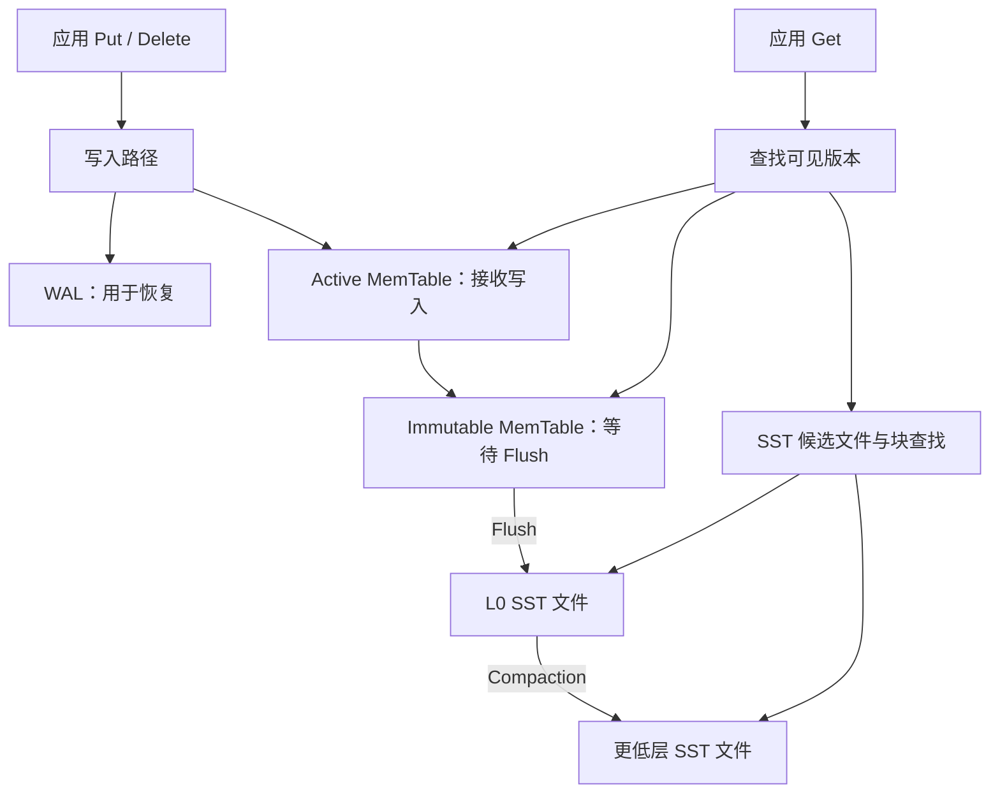

# RocksDB 学习路径：从存储基础到源码与性能实验

> 制定日期：2026-10-21。结合当前 CMU 15-445 笔记和既往 CUDA、深度学习系统学习记录制定。
> 本文是学习计划；编译、实验和性能测量尚未执行。官方资料已联网核对，具体 API、默认配置和构建要求以学习时固定的版本为准。

## 1. 你现在适合怎样开始

**你可以现在开始学习 RocksDB。适合你的路线是：补齐少量前置知识 → 手推 LSM → 做小实验 → 沿操作读源码 → 测量性能。** 第一轮目标是解释数据如何写入、查找、恢复和回收，并完成一次有依据的性能分析。

### 判断依据

| 依据 | 可以做出的判断 | 学习安排 |
| --- | --- | --- |
| 当前目录有 Storage I、Buffer Pool、Storage II 的 slides 和笔记 PDF | 有相关学习资料；文件存在不能证明已经掌握 | 用自测确认基础，不从整门课程重学 |
| [Hash Tables 笔记](../notes/07_hash_tables.md)已展开碰撞、负载因子和 Tombstone，部分章节仍是提纲 | 正在把数据结构与数据库访问路径联系起来 | 从哈希索引过渡到有序索引，保留手推练习 |
| [Indexes II 笔记](../notes/09_indexes2.md)目前主要是 Bloom Filter、Skip List 等主题的目录 | 无法认定这些机制已经掌握 | 把它们放在前置补齐阶段 |
| 既往 CUDA/PMPP、MiniTorch 学习记录 | 接触过内存层次、性能分析和沿调用关系理解程序的方法 | 采用“具体状态 → 执行过程 → 成本 → 源码”的学习方式 |
| 当前目录未见 RocksDB 源码、实验或恢复机制笔记 | 尚不能确认 RocksDB 实践、WAL、MVCC 和 C++ 工程熟练度 | 从小型 C++ 程序开始，恢复与版本可见性单独安排 |

历史记录可能未覆盖你最近的进度，只用于选择学习方法，不代表你已经熟练掌握全部相关知识。原 overview 中“已经学过 Indexes I & II”等表述，在这里改为可由文件支持的判断。

### 优先补齐的基础

1. **有序数据的查找与合并**：二分查找、Skip List、多路归并，以及 B+ Tree 的点查和范围扫描。
2. **持久化边界**：进程内存、OS 缓存、持久存储分别在什么故障下可能丢失。
3. **多版本可见性**：同一个 key 的旧值为何存在，读取如何选版本，删除为何需要记录。
4. **基本 C++ 工程能力**：编译和链接库、对象生命周期、返回状态检查、调试器。

如果 C++ 工程基础不足，额外安排 3–5 小时练习字符串、引用、RAII 和智能指针，达到能完成阶段 2 的程度即可。

## 2. 建立整体地图

RocksDB 是嵌入应用进程的持久化、有序 Key-Value 引擎。应用通过库接口操作字节串 key/value；SQL 解析、查询优化和网络服务由上层系统提供。第一轮限定为：**单进程、默认 Column Family、普通 Put/Get/Delete、Block-based SST、Leveled Compaction**。参见官方 [Overview](https://github.com/facebook/rocksdb/wiki/RocksDB-Overview) 和 [Getting started](https://rocksdb.org/docs/)。



写入分支表示职责，不表示 WAL 与 MemTable 的精确执行时序。SST 查找还涉及 Filter、Index 和 Block Cache；图中下层指 L1、L2 等，不保证每次 Compaction 都逐层经过。

| 已接触概念 | 可联系的 RocksDB 对象 | 需要分清的地方 |
| --- | --- | --- |
| Buffer Pool | Block Cache | 都能减少读取成本；Block Cache 缓存 SST 块，MemTable 接收新写入 |
| 内存哈希表 | MemTable 的索引结构 | 普通哈希表擅长点查；有序结构还能支持遍历和合并 |
| Page 与页内布局 | SST 数据块与索引 | 都有分块组织，但 SST 不能直接套成可原地修改的 Heap File 页面 |
| Hash Table Tombstone | LSM 删除记录 | 前者维持探测链；后者遮蔽其他位置的旧版本 |
| GPU 内存层次与带宽分析 | 缓存、SSD、后台 I/O | 可迁移测量方法；还要分析恢复、后台任务和延迟波动 |

组件职责参见 [Block Cache](https://github.com/facebook/rocksdb/wiki/Block-Cache) 和 [SST formats](https://github.com/facebook/rocksdb/wiki/A-Tutorial-of-RocksDB-SST-formats)。

## 3. 第一轮学习安排

建议投入 **约 40–55 小时**，每周 6–8 小时，约 6–9 周。这是第一轮预算，不是精通整个项目的时间保证。已有基础可自测跳过，通过验收后再继续。

| 阶段 | 时间 | 核心问题 | 必须留下的成果 |
| --- | --- | --- | --- |
| 0. 前置概念 | 3–4 小时 | 为什么排序、过滤和记录日志？ | 概念对照和手推题 |
| 1. 手推 LSM | 5–6 小时 | 一个 key 如何跨内存和文件演化？ | 状态表、读写路径图 |
| 2. 最小 C++ 实验 | 5–7 小时 | API 行为是否符合预测？ | 可重复运行的 demo |
| 3. 恢复、快照、回收 | 6–8 小时 | 成功返回、可见、持久化有什么关系？ | 故障边界表、快照实验 |
| 4. 按操作读源码 | 9–12 小时 | 机制落在哪些对象和函数中？ | 四条精简调用链 |
| 5. 性能与调参 | 8–12 小时 | 瓶颈如何测量和验证？ | 基线、对照实验、短报告 |
| 6. 综合复盘 | 3–5 小时 | 能否解释完整工作负载？ | 小应用与机制说明 |

### 阶段 0：补齐能够立即使用的基础

完成四个练习：

1. **B+ Tree 与有序文件**：画出点查、范围扫描路径，解释普通哈希表为何不直接支持有序扫描。
2. **Skip List**：为 `10, 20, 30, 40, 50` 画两到三层链，手推查找 35。先理解查找与插入，后续再读并发实现。
3. **Bloom Filter**：用 16 位数组和两个简单哈希函数模拟插入、查询，解释“可能存在”和“确定不存在”。
4. **文件写入**：画出“应用缓冲 → OS 缓存 → 持久存储”，区分进程崩溃与机器断电。

可选计算：标准 Bloom Filter 的理想模型中，插入数量为 $n$、位数组长度为 $m$、哈希次数为 $k$，误判率近似为：

$$
p \approx (1-e^{-kn/m})^k
$$

例如 $m/n=10$、$k=7$ 时约为 0.82%。这用于建立空间与误判率的直觉，具体实现与实测值会有差异。随后阅读官方 [Bloom Filter](https://github.com/facebook/rocksdb/wiki/RocksDB-Bloom-Filter) 的配置和误判率说明。

**验收问题**：Bloom Filter 能直接返回 value 吗？为什么加大 Filter 不等于降低所有类型查询的成本？

### 阶段 1：手推 LSM 数据生命周期

按“追加日志 → 内存有序结构 → Flush → 多个有序文件 → Compaction”学习。每加入一个组件，都回答：解决了什么问题，又引入什么成本？

用同一组操作贯穿本阶段，序号只是教学中的逻辑版本号：

```text
seq=1  Put("A", "v1")
seq=2  Put("B", "b1")
       Flush，形成 F1
seq=3  Put("A", "v2")
seq=4  Delete("B")
       Flush，形成 F2
       Get("A")
       Get("B")
       对相关 SST 做 Compaction
```

| 时刻 | 状态或结果 | 检查点 |
| --- | --- | --- |
| 第一次 Flush 后 | F1 包含 A、B 的旧值 | 后续覆盖不需要原地修改 F1 |
| 第二次 Flush 后 | F2 包含 A 新值和 B 删除记录 | 多个文件可能包含同一 key 的记录 |
| 最新视图 Get(A) | v2 | 为什么不能任意选一个文件的匹配项？ |
| 最新视图 Get(B) | 不存在 | 为什么不能继续返回 F1 的旧值？ |
| Compaction 后 | 输出取决于可见性和合并范围 | 是否还有 Snapshot 或更低层旧值？ |

第一遍采用“没有 Snapshot、相关旧数据全部纳入合并”的条件讨论回收，阶段 3 再解除这些简化。

随后学习 Leveled Compaction：L0 文件范围可能重叠，非零层按有序范围组织，由此解释 L0 积压为何影响查询。不要记死“L0 永远合并到 L1”，动态层级配置可能让 L0 直接进入更低的目标层。参见 [Leveled Compaction](https://github.com/facebook/rocksdb/wiki/Leveled-Compaction)。

**验收问题**：只 Flush 而不 Compaction 会积累什么问题？这两种操作分别读取什么、生成什么？

建议产物：`01_lsm_basics.md`，包括状态表和一次三路有序归并。

### 阶段 2：最小 C++ 实验

**环境建议**：你当前使用 Windows。若已有 Linux 主机或 WSL2，可在那里构建；WSL 中的性能实验数据库建议放在 Linux 文件系统内，并记录存储位置。Windows 原生构建也可按官方说明完成。这里不假定当前已安装 WSL 或验证过编译环境。

选择一个 release tag，记录 commit、编译器、构建参数，学习期间固定版本。调试使用适合断点跟踪的构建，测速用 Release。按所选版本的 [INSTALL.md](https://github.com/facebook/rocksdb/blob/main/INSTALL.md) 准备环境，避免混用旧博客要求。

写一个小型 demo，依次完成：

1. 在独立实验目录打开数据库，写入 A、B，读取并检查 Status。
2. 覆盖 A、删除 B，验证结果，区别 NotFound 与其他错误。
3. 用 WriteBatch 提交一组修改，理解批量原子写入的语义。
4. 用 Iterator 的 Seek、Next 遍历，记录顺序并检查迭代结束状态。
5. 主动 Flush，观察目录文件；关闭后重开并核对值。

接口入口读 [Basic Operations](https://github.com/facebook/rocksdb/wiki/Basic-Operations)。同时记录 Slice 引用的数据由谁持有、Iterator 何时销毁，避免生命周期问题干扰机制学习。

**验收问题**：默认字节序比较下，字符串 `"10"` 与 `"2"` 谁在前？需要数值顺序时怎样编码 key？为什么正常关闭再打开不能证明崩溃恢复正确？

建议产物：`02_api_and_files.md` 和 demo。暂时只使用默认 Column Family。

### 阶段 3：恢复、快照与回收

写 WAL 为恢复提供记录；WAL 同步涉及持久化边界；MemTable Flush 把内存表写成 SST。不能用一个“落盘”概括这些操作。参见 [WAL](https://github.com/facebook/rocksdb/wiki/Write-Ahead-Log-%28WAL%29)。

| 显式配置 | 要理解的语义 |
| --- | --- |
| WAL 开启，`sync=false`，`manual_wal_flush=false` | 已完成写入的 WAL 通常已交给 OS；进程崩溃和机器崩溃有不同边界 |
| WAL 开启，`sync=true` | 返回前要求完成相应同步；依赖文件系统与设备正确实现持久化语义 |
| `disableWAL=true` | 尚未持久化到 SST 的写入可能在进程崩溃后丢失 |
| `manual_wal_flush=true` | 另行分析用户态 WAL 缓冲与显式刷新，不能沿用第一行假设 |

选项关系见 [Synchronous / Non-sync Writes](https://github.com/facebook/rocksdb/wiki/Basic-Operations#synchronous-writes)。

**实验 A：进程崩溃恢复。** 写入进程在操作返回后报告已确认 key，由独立控制进程记录确认结果并终止写入进程，随后重开数据库核对。用小数据量尽量避免提前 Flush，并检查实际文件和日志。一次没丢数据不能证明配置永远安全；终止进程也不能模拟断电。

**实验 B：快照可见性。**

```text
Put(A, v1)
取得 Snapshot S
Put(A, v2)
读取最新视图的 A       -> v2
使用 S 读取 A          -> v1
Delete(A)
读取最新视图的 A       -> 不存在
使用 S 读取 A          -> v1
释放 S
```

在普通、无特殊事务模式的教学模型中，读视图序号为 $S$，版本序号为 $s$：先筛选 $s \leq S$ 的版本，再选其中最新一条；若选中删除记录，就返回不存在。Snapshot 是某时刻的读视图，不是持久化备份，不会跨数据库重启保留。参见 [Snapshot](https://github.com/facebook/rocksdb/wiki/Snapshot)。

**验收问题**：释放 Snapshot 后文件为何不一定立即变小？删除记录的安全回收，为何既要考虑旧读视图，又要考虑合并范围外的旧值？

建议产物：`03_wal_snapshot_recovery.md`。以后学习课程中的恢复和 MVCC 时返回对照。

### 阶段 4：沿四个问题读源码

每次只跟踪一个实验，先记录输入、关键对象和状态变化，再补函数名。第一遍可把复杂分支折叠成一句职责说明。

| 主线 | 官方源码入口 | 本次回答的问题 |
| --- | --- | --- |
| Put / Write | [db_impl_write.cc](https://github.com/facebook/rocksdb/blob/main/db/db_impl/db_impl_write.cc) | 请求怎样组成批次？WAL、MemTable、序号分配如何连接？ |
| Get | [db_impl.cc](https://github.com/facebook/rocksdb/blob/main/db/db_impl/db_impl.cc) | 读视图在哪里确定？内存与 SST 的候选结果怎样汇合？ |
| Flush | [flush_job.cc](https://github.com/facebook/rocksdb/blob/main/db/flush_job.cc) | 哪个 MemTable 被处理？SST 怎样生成并成为可读取状态？ |
| Compaction | [compaction_job.cc](https://github.com/facebook/rocksdb/blob/main/db/compaction/compaction_job.cc) | 文件怎样合并？何处判断旧版本保留和删除？ |

链接指向会变化的 main，用于导航；实际笔记记录固定 commit 的路径和行号。先用 rg 搜索 `DBImpl::Get`、`WriteImpl`、`FlushJob`、`CompactionJob`，再用调用位置或调试器确认所选版本的路径。

每条路径留下四项：

1. 5–10 个节点的调用关系图。
2. 对象表：存什么、谁持有、何时改变或失效。
3. 一个具体 key 的执行轨迹。
4. 尚未深入的问题，以及以后返回阅读的条件。

读到 Internal Key，再研究 user key、sequence number、value type 的组合和比较。读到文件集合变化，再研究 Version、VersionEdit、MANIFEST，并与 WAL 记录用户修改的职责区分开。

**验收问题**：指着源码说明 MemTable 命中与 SST 命中的 Get 从哪里分叉；为什么生成新文件后还需要发布相应元数据？

建议产物：`04_write_path.md`、`05_read_path.md`、`06_flush_compaction.md`。主流程连通后再选并发写、事务、异步 I/O 等分支深入。

### 阶段 5：预测、测量、解释性能

先固定工作负载：key/value 大小、读写比例、顺序或随机、热点分布、同步持久化要求，再比较配置。

定义放大指标并注明口径：

$$
WA = \frac{\text{测量窗口内存储层写入字节}}{\text{同窗口应用逻辑写入字节}}
$$

$$
SA = \frac{\text{选定口径的数据库文件占用字节}}{\text{当前存活 key/value 的逻辑字节}}
$$

读放大可以记录候选文件数、块读取数或设备读取次数，需选定并命名清楚。缓存命中的逻辑读取不等于 SSD I/O。WA 要注明是否含 WAL、Flush、Compaction，计数来自引擎还是 OS；SA 要注明是否含 WAL、临时输出和压缩。参见 [Tuning Guide](https://github.com/facebook/rocksdb/wiki/RocksDB-Tuning-Guide)。

使用官方 [db_bench](https://github.com/facebook/rocksdb/wiki/Benchmarking-tools) 建立基线，先读当前编译版本的 `-help`。以下是待执行的实验：

| 实验 | 保持相同 | 改变因素 | 观察 |
| --- | --- | --- | --- |
| 顺序 / 随机写 | 规模、值大小、持久化设置 | fillseq / fillrandom 工作负载 | 吞吐、SST 分布、合并；若比较纯顺序影响，控制重复 key 比例 |
| Bloom Filter | 数据集、SST 布局、查询集合 | 关闭 / 开启 | readmissing 的读取成本、Filter 统计、延迟 |
| Block Cache | 查询分布、其他内存预算 | 两个缓存容量 | 命中率、吞吐、读取成本，同时检查 OS 缓存 |
| 同步写 | 单线程、相同写入次数、WAL 设置 | sync=false / true | 吞吐、延迟，以及持久化保证变化 |
| 后台积压 | 持续写入负载、硬件、其他参数 | 一个后台任务相关设置 | L0 文件数、待合并数据量、stall 时间、尾延迟 |

Filter 实验分别创建对应配置的新数据库，或确认相关 SST 已重新生成。只在打开旧库时改选项，不能当作重建了文件中的 Filter。

实验规则：

1. 保存版本、命令、配置、硬件、文件系统、数据规模、随机种子和原始输出。
2. 使用独立实验库，尽量保持对照组初始数据和 LSM 状态一致。
3. 区分预热与测量，注明热/冷缓存；重开 DB 不会自动清空 OS 缓存。
4. 小数据先验证工具，再增加规模或时间，直到实际覆盖多次 Flush、Compaction 等目标机制。
5. 一次改一个因素，重复至少三次，报告中位数、波动、后台任务状态。
6. 记录吞吐、可获得的延迟分布、CPU/I/O 和层级统计。需要请求级 p99 时，核实工具记录的是请求延迟还是内部事件耗时。

阅读 [Write Stalls](https://github.com/facebook/rocksdb/wiki/Write-Stalls)，解释后台积压怎样限制前台写入。调大阈值改变可容忍积压的范围，不能凭空增加后台处理能力。

**验收问题**：吞吐提升但 p99 变差，可以直接叫优化成功吗？增加缓存没提升时，怎样区分缓存已够大、OS 缓存命中、CPU 开销或负载不合适？

建议产物：`07_benchmark_and_tuning.md`。第一轮完成两组能解释因果关系的对照实验，其余后续继续。

### 阶段 6：做一个能解释到底的小应用

实现命令行 KV 工具，支持 put/get/delete/scan，再加入 WriteBatch 和 Snapshot 演示。使用顺序明确的 key 编码，为小数据集准备内存参考结果。

综合验收：

- [ ] 插入、覆盖、删除、范围扫描与参考结果一致。
- [ ] 能解释关闭重开与异常终止实验分别验证什么。
- [ ] 能画出记录从写入到 SST、再到 Compaction 的路径。
- [ ] 能解释旧版本可见性与 Tombstone 延迟回收。
- [ ] 能指认读写对应的核心源码位置。
- [ ] 能用原始数据说明配置改善了什么、付出了什么成本。

到这里，应能独立使用 RocksDB 做小实验，理解主要机制，并带着问题继续读源码。

## 4. 与 CMU 15-445 怎样配合

让课程建立通用概念，让 RocksDB 提供具体实现和观测对象。

| 课程主题 | 联动任务 |
| --- | --- |
| Storage / Buffer Pool | 对比 Page、SST Block、Block Cache、MemTable |
| Hash / Tree Indexes | 对比点查、范围扫描、有序归并的需求 |
| Bloom Filter / Skip List | 完成阶段 0，再返回读路径与内存表 |
| Logging / Recovery | 深入阶段 3 的故障边界与 WAL 恢复 |
| Concurrency / MVCC | 理解 Snapshot，再看并发写与事务接口 |

不必等完整学完课程再做最小实验。若课程项目临近截止，先完成阶段 0–2，每周用一次短实验维持学习，源码与调参后移。

## 5. 后续方向与第一周行动

完成主线后，再选择一个进阶方向：

| 方向 | 下一步 | 开始前的基础 |
| --- | --- | --- |
| 存储引擎实现 | 简化 LSM、SST 编码、迭代器、元数据恢复 | 能手推合并并解释基本恢复 |
| 性能工程 | Compaction 策略、压缩、缓存、后台并行度 | 有可复现实验，能区分 CPU、I/O、后台积压 |
| 应用系统 | Column Family、事务、Checkpoint/Backup | 能区分批量原子性、读视图、持久化、备份 |
| GPU 与存储交叉 | 测量合并、排序、压缩后再评估加速 | 已证明目标阶段是瓶颈，并计入传输和调度成本 |

GPU 可以成为你后续的特色方向。先用 CPU 和 I/O 实测选择问题，再判断是否值得引入 GPU。

**第一周只安排四次学习：**

1. **60–90 分钟**：复习 Buffer Pool、有序索引，自测“MemTable 为什么不能直接理解成 Buffer Pool”。
2. **60–90 分钟**：手推 Skip List、Bloom Filter，记录一次误判。
3. **约 2 小时**：完成 A/B 两个 key 的 LSM 状态表，解释覆盖和删除。
4. **约 2 小时**：选定版本和环境，开始最小 demo，单独记录构建问题。

每次结束写三句话：**今天解释清楚了什么；通过哪个例子或实验确认；下次解决哪个具体问题。** 后续笔记按建议文件名逐步建立，不必提前铺满空白章节。
