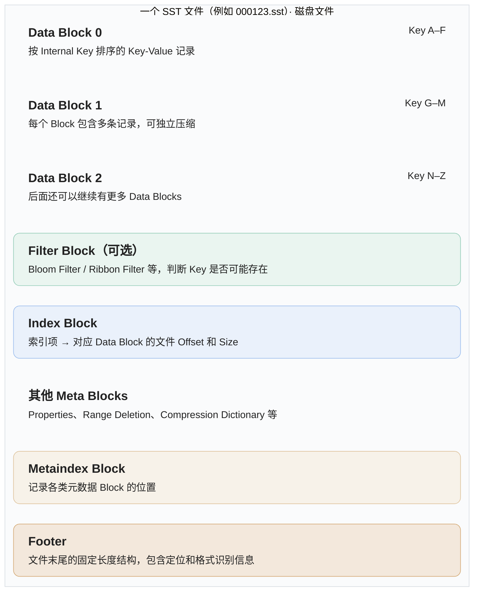
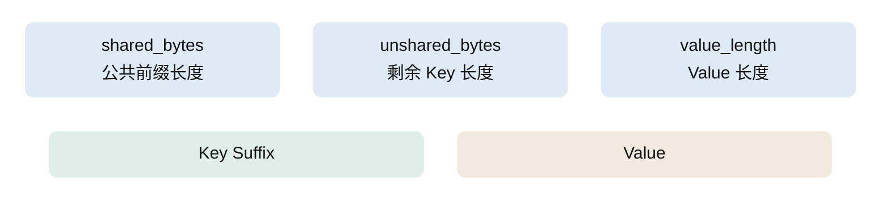

# sst file 内部是怎么组织的？

https://chatgpt.com/s/t_6ae2b8f84d8c8191980066eda5e3c432

## sst file 整体结构

> 概念示意图：各类元数据 Block 的实际排列顺序、索引组织及 Footer 编码与长度随格式版本变化，并非严格固定为图中顺序。Key 范围仅作示例。

### data block

前三个长度通常使用 varint32 编码，这是经典的 Key-Value 交替存储布局。图中分两行展示，实际字段按 `shared_bytes → unshared_bytes → value_length → Key Suffix → Value` 顺序编码。
### index block

